# ZED ZONE: Smart Companions — Tactical AI, Base Sorting & Live Chatter

<p align="center"><a href="https://boosty.to/lrgpp"></a></p>
<p align="center"><em>Enjoy the mod? Support its development on <a href="https://boosty.to/lrgpp">Boosty</a>.</em></p>

<p align="center">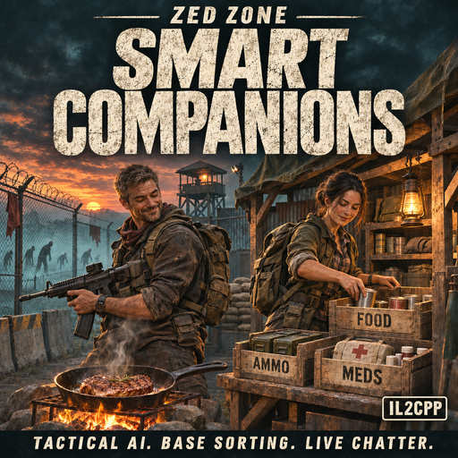</p>

<p align="center">
  <a href="https://steamcommunity.com/sharedfiles/filedetails/?id=3836613312"><strong>Steam Workshop (3836613312)</strong></a> ·
  <a href="https://github.com/druidqwerty/ZedZoneSmartCompanions/releases/tag/v3.0.0"><strong>Release v3.0.0 ZIP</strong></a> ·
  <a href="README_RU.md"><strong>Русская документация (README_RU.md)</strong></a> ·
  <a href="README_CN.md"><strong>简体中文文档 (README_CN.md)</strong></a>
</p>

---

## New in v3.0.0 — Expeditions milestone: vehicle crews, multi-floor (zLevel) navigation & pet synergy

- **Organized vehicle crews & overflow policy (`BasicVehicle`):** when you take the wheel, critically wounded teammates, `Medic`s and `Fighter`s receive priority seats (`PlanVehicleSeatAllocation`), while overflow squadmates hold cleanly at camp/standby instead of crowding vehicle doors; `Supplier` specialists perform physical parked bodywork upkeep (`<= 2.45 m`).
- **Physical multi-floor & bunker transitions (`TerrainObject_Door_UndergroundEntrance`, `DugShaft`, `zLevel`):** companions locate the nearest stairway/bunker hatch on their current `zLevel`, walk to the portal (`<= 2.15 m`, zero ceiling teleportation!), resolve `GetMigrateDestination`, and transition floors atomically.
- **Pet companion synergy (`PetSystem`, `F8 → Squad`):** live friendly pet summary in **F8 → Squad**, vehicle boarding assistance (`TryBoardOwnerVehicle`), strict friendly-fire protection, and physical pet feeding from `Farming & Pets` supplies.
- **Verified:** full live combat + physical carry + 80-chest soak + Camp Garrison + SafeDismiss + `GrenadeSafetyGate` + Bio-Masks + Fuel Whitelist + live `v3.0.0` vehicle/floor/pet checks; 300/300 graphical cases; all 8,386 save files unchanged. [Scope and limits](docs/verification-3.0.0.md).

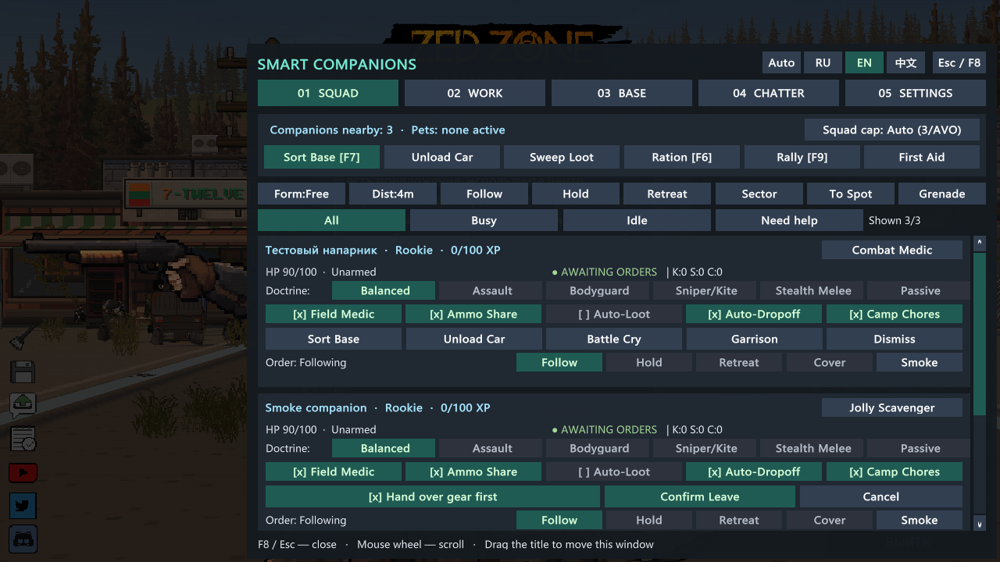

## New in v2.7.0 — Industrial base & power grid (zero teleportation)

- **Zero-teleport generator, heater & battery care (`F8 → Work`):** companions physically carry approved fuel from storage chests into `StirlingGenerator` and `Heater` stations (`<= 2.45 m`) and rotate depleted / `100%` charged batteries in `BatteryCharger`.
- **Furnace & kitchen unloading:** collects finished ingots, charcoal and cooked meals from `Furnace`, `ElectricFurnace`, `Stove` and `CookingHob` stations into categorized base chests.
- **Strict fuel whitelist (`IsApprovedStationFuelItem`):** never burns weapons, armor, clothing, medicine, food, books, cash, batteries, planks or rare vehicle parts — only explicit fuels enter fuel slots.
- **Verified:** live combat + physical carry + garrison + safe dismiss + `GrenadeSafetyGate` + saved-mask protection + live fuel whitelist; 300/300 graphical cases; all 8,386 save files unchanged. [Scope and limits](docs/verification-2.7.0.md).

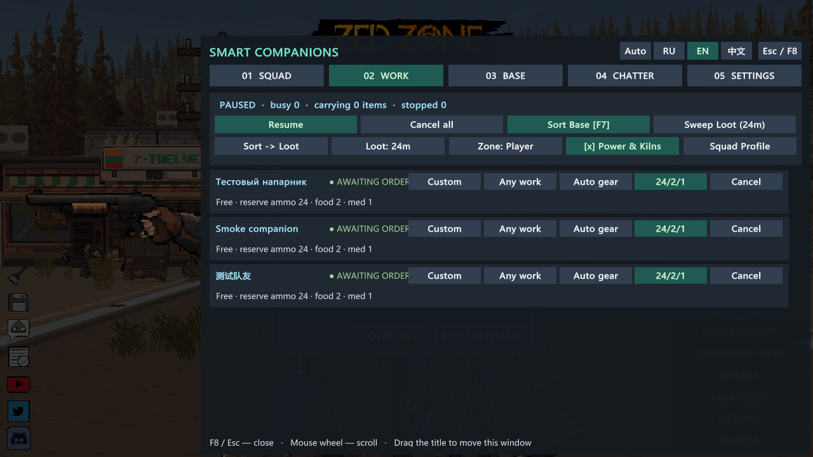

## New in v2.6.0 — Autonomous survival: bio-masks, debuff remedies & sentry sleep shifts

- **Auto gas masks in blood rain & radiation (`GOAPAction_EquipFaceMask`):** companions automatically equip protective masks during hazards, keep their everyday bandana/mask safe from base sorting (`SavedEverydayMaskByGuid`), and re-equip it once the air clears.
- **Debuff & environmental care (`GOAPAction_ClearDebuff_*`):** treats burning, fever, hypothermia and spores using ordinary remedies first while strictly respecting your rare-serum rule.
- **Sentry-guarded sleep rotation (`GOAPAction_Sleep`):** exhausted companions walk (`<= 2.45 m`, 0 teleport) to camp beds in shifts so at least one watchman always stays awake, waking everyone immediately if combat starts.
- **Verified:** live combat + physical carry + garrison + safe dismiss + `GrenadeSafetyGate` + live saved-mask reserve protection; 300/300 graphical cases; all 8,386 save files unchanged. [Scope and limits](docs/verification-2.6.0.md).

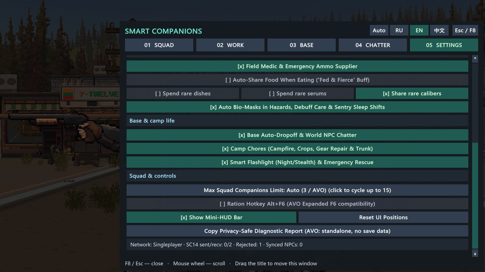

## New in v2.5.0 — Field tactics 2.0: cursor fan orders, cover, safe grenades & medic rescue

- **Move-to-Cursor fan order (`Alt+G`, `F8 → Squad → To Spot` & radial menu):** send a fighter or the whole squad in a non-overlapping fan (`>= 1.25 m` spacing) to your mouse cursor.
- **Smart ranged-fire cover (`GOAPAction_TakeCover`):** companions automatically take cover during firefights against armed looters and raiders.
- **Offensive grenades with `GrenadeSafetyGate` (`F8 → Squad → Grenade`):** attacks enemy clusters (`>= 3`) or bosses while strictly blocking throws within `6.5 m` of players/allies/pets or `18.0 m` of marked base chests.
- **Healing smoke & Medic rescue (`Alt+H`, `Smoke` button & radial menu):** deploys medical smoke (with field-bandage fallback), while Medics autonomously rescue critically wounded teammates (`< 32% HP`).
- **Verified:** live combat + physical carry + Camp Garrison + SafeDismiss + live `GrenadeSafetyGate` check; 300/300 graphical cases; all 8,386 save files unchanged. [Scope and limits](docs/verification-2.5.0.md).

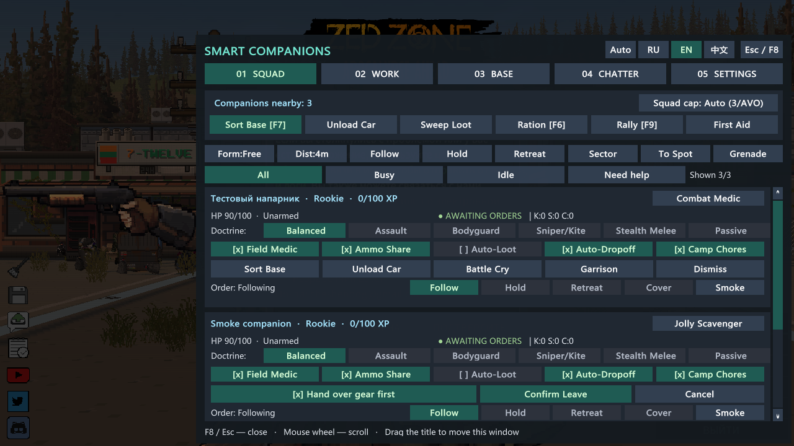

## New in v2.4.0 — Camp garrison, safe gear handover & co-op telemetry

- **Camp Garrison mode (`F8 → Squad` & radial menu):** leave chosen companions guarding your base perimeter and running storage/crop duties instead of chasing you on distant raids; base sorting continues discovering chests near garrisoned companions while you are away.
- **Safe two-step dismissal (`0` item teleportation):** confirm before dismissing a companion and optionally have them physically walk over (`<= 2.45 m`) to deposit weapons, armor and backpack items into a marked base chest or your inventory before leaving.
- **Co-op sync health bar (`F8 → Settings` & Diagnostics):** live network status, `SC14` packets sent/received, rejected unauthorized edits and synced human NPC counts without exposing names, paths or coordinates.
- **Verified:** live combat + physical carry + tactical orders + 80-chest soak + Camp Garrison hold (12 m raid separation) + SafeDismiss physical walk & handover; 300/300 graphical cases; all 8,386 save files unchanged. [Scope and limits](docs/verification-2.4.0.md).

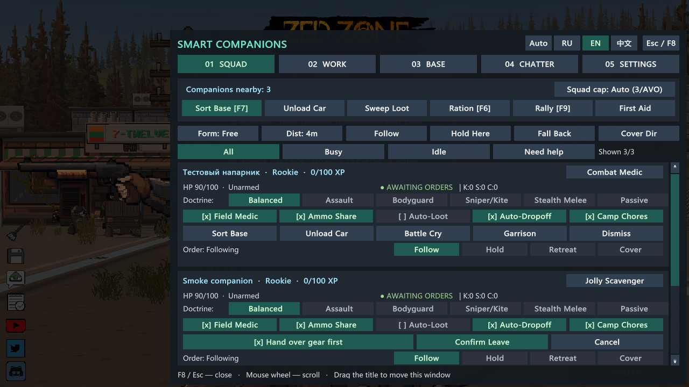

## New in v2.3.0 — Performance, 15-NPC scale & privacy-safe diagnostics

- **Lighter item, container & target searches:** frame-cached squad queries, `O(1)` item-category memoization, spatial/time world container caching and shared hostile snapshots keep 80+ chest bases and 15-person squads responsive.
- **Large warehouses & 15-companion squads:** verified priority-sorted routing across 80-chest / 960-item warehouses (`0.11 ms` in live engine) and non-overlapping formations & profile previews for 15 companions.
- **Stronger AVO Expanded compatibility:** detects AVO via BepInEx IL2CPP plugin metadata and loaded assemblies, keeps AVO's squad cap intact in `Auto` mode, protects `F6` via `Alt+F6`, and shows live AVO status in Settings.
- **One-click privacy-safe diagnostic report (`F8 → Settings`):** copies a bug-report summary to clipboard and saves `SmartCompanions_Diagnostics.txt` with **zero** save data, names, Steam IDs, OS paths or coordinates.
- **Verified:** live combat + physical carry + tactical orders + reserves + 20-cycle live soak + transition & co-op reconnect checks + 300/300 graphical cases; all 8,386 save files unchanged. [Scope and limits](docs/verification-2.3.0.md).

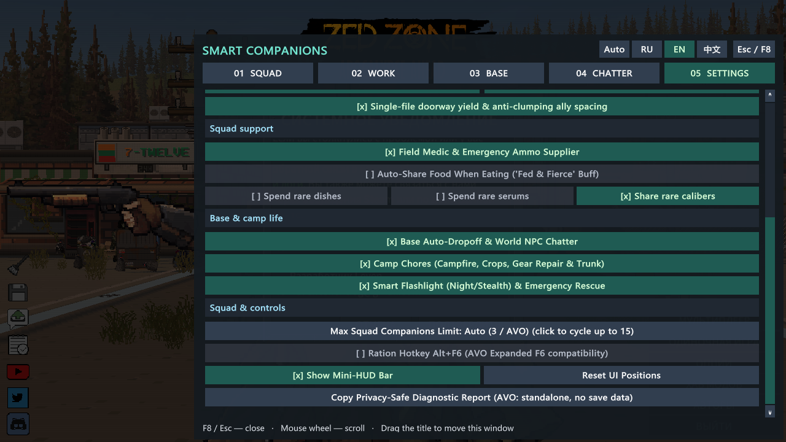

## New in v2.2.0 — Specializations, supply reserves & loot zones

- **Companion specializations (`F8 → Work`):** Fighter, Medic, Supplier or Scavenger presets per companion, plus a non-mutating **Squad Profile preview** showing exact diff counts before applying to the whole squad.
- **Preferred loadout & non-reducible reserves:** choose Auto gear, Ranged or Melee preference and minimum backpack reserves (`24/2/1`, `45/3/2`, `60/4/4` for Ammo / Food / Medicine) that base sorting and auto-dropoff never strip.
- **Rare-supply permissions (`F8 → Settings`):** independent toggles to protect gourmet steaks, rare serums/blood bags and rare heavy calibers during routine sharing and field healing.
- **Loot zones & base priorities (`F8 → Work`):** choose Sort / Loot / Camp priority order, set loot sweep radius (`14–48 m`) and pin a scavenging zone at a chosen spot while base chests stay protected.
- **Verified:** live combat + physical carry + tactical orders + live `ItemData` backpack reserve & rare-steak protection in the real game; 300/300 graphical cases; all 8,386 save files unchanged. [Scope and limits](docs/verification-2.2.0.md).

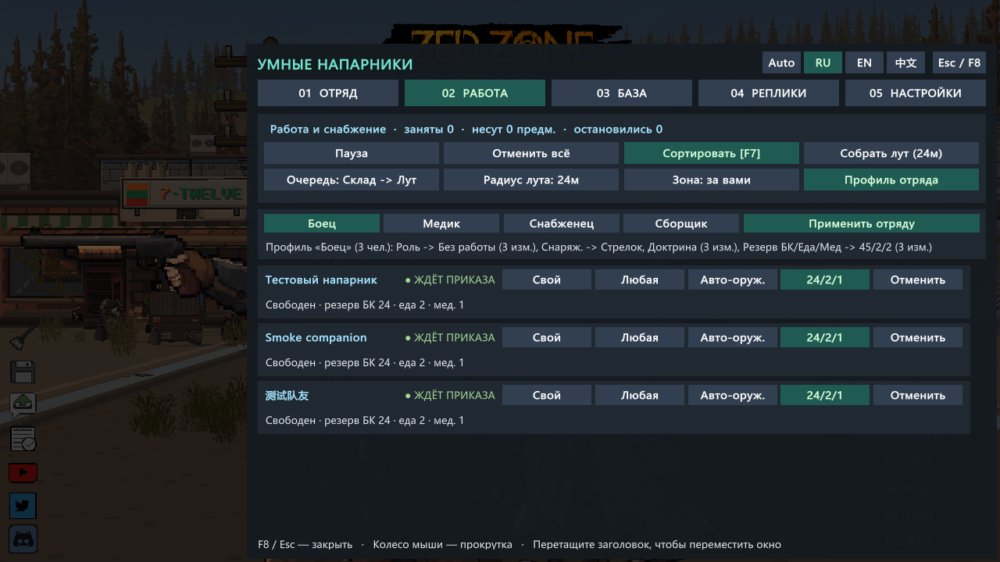

## New in v2.1.0 — Tactical squad control

- **Formations & follow distance:** choose Free, Wedge, Line, Column or Guard Ring and 2.5 m, 4 m, 6.5 m or 9 m follow distance right in **F8 → Squad** (or Settings), keeping your aim line clear.
- **Hold Position, Fall Back Here & Cover Direction:** anchor companions on a defensive line, recall them to your position at a run, or prioritize enemies in your aim sector — for the whole squad, per companion, or via the radial NPC menu.
- **Narrow-passage yield & ally spacing:** trailing companions yield single-file in tight doorways and avoid stacking on teammates.
- **Wounded & low-ammo retreat rules:** configure HP (`Off / <25% / <30% / <50%`) and ammo (`Off / 0 ammo / <=5 ammo`) retreat thresholds, with clear order and block/retreat status on every card.
- **Verified:** live combat + physical carry + Hold Position (0 m drift) + Fall Back Here run + Cover Sector priority in the real game; 300/300 graphical cases; all 8,386 save files unchanged. [Scope and limits](docs/verification-2.1.0.md).

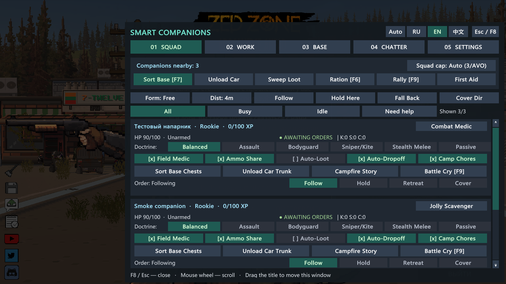

## New in v2.0.0 — Base work board

- **New WORK tab (F8, second tab):** every companion's state, current job, carried items, loot stops left and why work stopped, on one board.
- **Work roles:** Any work, Storekeeper, Scavenger, Camp keeper or No base work. Roles limit automatic and whole-squad work; direct orders to one companion always apply.
- **Pause / Resume:** companions keep their current job and carried items and follow you; resume and they finish. A direct sort or loot order ends the pause.
- **Cancel** one job or all jobs; carried items stay in the backpack. Nothing is dropped or teleported.
- **Co-op:** roles and pause go through the host-checked order system; allies' companions are view-only.
- **Verified:** live combat + physical loot + chest carry with a 4-second mid-carry pause and resume (0 teleports) in the real game; 300/300 graphical cases with the new tab; all 8,386 save files unchanged. [Scope and limits](docs/verification-2.0.0.md).

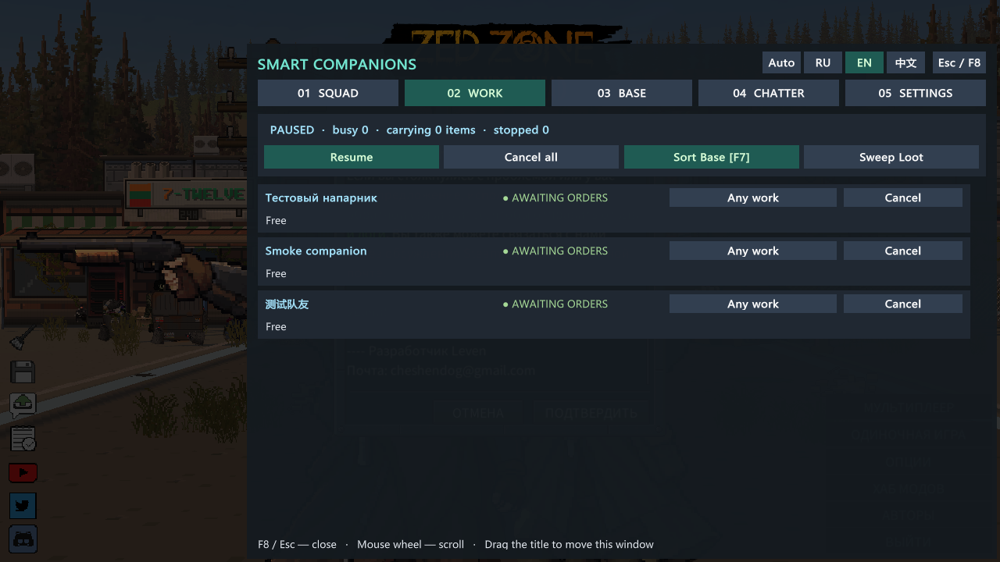

## New in v1.9.0 — Safer co-op orders

- **The host checks every order:** only the owning player can change a companion's doctrine or ownership.
- **No tug-of-war:** simultaneous changes resolve to the first one, and the host re-sends the real state so all screens agree. Quick clicks by the owner still apply in order.
- **View-only cards** for companions owned by another player (🔒 with the owner's name).
- **Mixed 1.8.x/1.9.0 sessions keep working**; update both players for full protection.
- **Verified:** co-op decision table 13/13 in the real game; 270/270 graphical cases; all 8,386 save files unchanged. A real two-player network session is still untested. [Scope and limits](docs/verification-1.9.0.md).

## New in v1.8.1 — See what every companion is doing

- **Clear state on every card:** Awaiting orders, Busy, In combat, Stopped or Needs help, in colour.
- **Why work stopped:** no path to a named chest, no space or chest for listed categories, no chests with categories, or interrupted by combat.
- **Squad filters:** All, Busy, Idle and Need help (HP below 50%, hungry or thirsty) with a shown/total counter.
- **Hover hints** for doctrines, companion toggles, filters and counters.
- **Verified:** 270/270 graphical cases on six resolutions and three languages; all 8,386 save files unchanged. [Scope and limits](docs/verification-1.8.1.md).

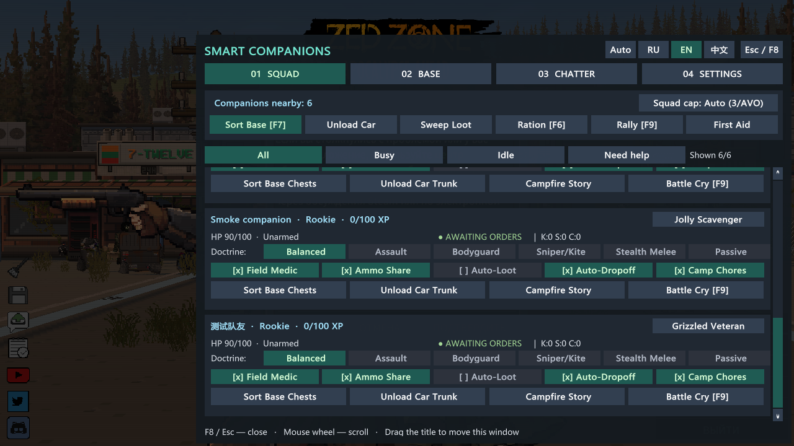

## New in v1.8.0 — A clearer interface for your screen

- **Four focused F8 tabs:** Squad, Base, Chatter and Settings. Combat orders, storage rules, dialogue controls and preferences are easier to find.
- **Readable display:** refreshed teal/neutral styling, larger text and grouped settings.
- **Automatic screen scaling:** the hub, HUD and chest category bar share one scale; automatic mode follows screen height and available space, including widescreen layouts.
- **Your preferred size:** choose Auto or 75%, 100%, 125%, 150%, 175%, 200% in **F8 → Settings → Interface & scale**. The effective size is capped to keep the full window on screen; the displayed percentage shows the actual result.
- **Live changes:** resolution and scale changes reposition panels within the screen. No restart is needed for UI preferences. Existing gameplay and physical item transport remain unchanged.
- **Cleaner chest controls:** wrapped container names get enough row height; compact categories use a four-column grid. The chest overlay stays hidden behind F8, and closing the hub releases drag/scroll capture.
- **Verified:** 270 graphical cases across six resolutions and three languages; scaled clicks, scrollbar buttons, dragging and close at 75%/200%. [Scope and limits](docs/verification-1.8.0.md), including unverified automated wheel delivery. Real two-player human NPC visibility remains unverified.

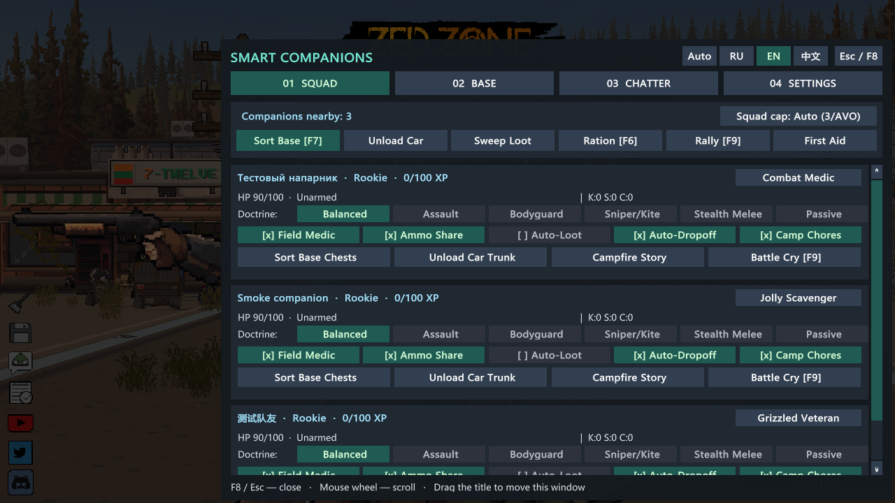

## New in v1.7.0 — True Physical Looting & Item Transfer (Zero Item Teleportation)

- **Physical Ground, Corpse & Wild Container Scavenging (`AutoLootSystem_JobRunner.cs`, `AutoLootSystem_Transfer.cs`, `PhysicalMovementHelper.cs`):**
  - Removed all instant/remote loot pickup loops. When ordered to sweep loot (or auto-looting nearby), companions build a distance-ordered `LootQueue`, walk from target to target using obstacle-aware A* pathfinding (`agent.MoveTo` + `ComputeSurfaceDistance` against the target collider's outer edge), pause briefly (`0.35s`) within `<= 2.45m` reach, and transfer items only upon physical arrival.
- **Physical Chest-to-Chest Base Sorting (`F7`, `BaseSortingSystem_Worker.cs`, `BaseSortingSystem_PhysicalCarry.cs`):**
  - Removed the instant-teleport sort button (`⚡ Instant Sort`). Companions walk to each source/drop-off chest (`SortingPhase = 1`), pause to take a batch into `CarryBuffer` at close range, walk to each categorized destination chest (`SortingPhase = 2`), and place items inside.
- **Non-Teleporting Combat Rollback & Chores (`BaseSortingSystem_CarryOps.cs`, `BaseChoreSystem.cs`):**
  - If combat interrupts a carry job or a destination chest becomes unreachable, `ReturnCarryBufferWithoutTeleport` keeps carried items in the companion's own inventory (`sharedInventoryData` / `inventoryData`) or drops them at their feet (`DropItem`) instead of teleporting items back across the base.
- **Verification:** Live-verified across all 6 engine phases (`57` Harmony patches, `[SelfVerify] PASS v1.7.0`, Phases 0–3 zombie/bandit ranged combat & cease-fire `PASS`, Phase A `6.77m` ground loot walk `PASS`, Phase B `1.64m` chest-to-chest carry walk `PASS`, `0` teleports, `8,386 / 8,386` save `GameData` hashes untouched); see [docs/verification-1.7.0.md](docs/verification-1.7.0.md).

## New in v1.6.0 — Full Forensic Audit, Clean Rebuild, Puppet/Weapon Guard & Cease-Fire Fix

- **Fixed Native `MonsterAttr` IDs & Player `CharacterData` Protection (`0 = Player`, `200 = Looter`, `201 = Survivor`, `202 = SecurityGuard`):**
  - Corrected `LooterMonsterAttrId` from `202` (`Augmented Security Officer`) to `200` (`Looter`), added `IsAnyPlayerCharacterData` hard guards (local + remote co-op players) so player `characterAttrId = 0` is never modified, automatically repairs non-guard NPCs previously misassigned to `202` back to `201`/`200`, and scopes `MonsterAttr` threat tuning strictly to `Looter (200)`.
- **Complete Equipment & Hand-IK Lifecycle Guard (`HumanNpcEquipmentGuard`) + Host Active NPC Rescue:**
  - Protects all non-local-player humans (companions, world NPCs, client puppets, and remote player puppets) regardless of `IsMultiplayerOnline`, allocates backing `InventoryData` before `LoadEquipments` / `EquipRangedWeapon` / `EquipMeleeWeapon`, cleans up broken weapon state without aborting `HumanCharacterController.Init()` or `BasicCharacterController.Start() -> GameController.AddCharacter()`, validates all hand IK pointers in `UpdateHand_RangedWeapon` (`0` weapon/hand NREs in `Player.log`, down from `2,903`), and rescues any active host NPCs missing from `GameController.characterList`.
- **Combat AI, Strict Cease-Fire (`StopFire` / `Passive`), Ghost Threat Pruning & Chat Hotkey Gating:**
  - Hard-zeroes friendly/neutral human threat scores across all doctrines, enforces `GOAPGoal_EliminateThreat` suppression in `StopFire` / `Passive`, prunes culled/inactive (`!activeInHierarchy`) ghost threats, requires `IsAnyAlliedPlayerCharacterId` in `IsPlayerTeammate`, stops false rear-flank callouts on peaceful camp NPCs, syncs `NPC_DISMISS` & `AutoCompact` in co-op, and blocks `F6–F9` while typing in chat (`Esc` closes `F8`).
- **Verification & Co-op Note:** Live-verified in the ZED ZONE engine (`55` Harmony patches, `[SelfVerify] PASS v1.6.0`, Phases 0–3 zombie/bandit ranged combat & cease-fire `PASS`, `8,383 / 8,383` save `GameData` hashes untouched). Real two-player host+client human NPC visibility still awaits live two-player co-op confirmation; see [docs/verification-1.6.0.md](docs/verification-1.6.0.md).

## New in v1.5.0 — Companion Dismissal Fix, Draggable UI, Squad Limit (up to 15), AVO Compatibility & Autonomous Scavenging

- **Fixed Companion Dismissal (`QuitTeam` / `RemoveTeamNPC` / `UnFollowPlayer`):**
  - Fixed a bug where `MultiplayerSyncSystem.SyncCompanionOwnerAndLeader` restored `leaderCharacterGUID` after a companion was dismissed, causing dismissed companions to keep following the player even after disappearing from the top-left team panel. Dismissed companions now cleanly leave the squad, flush any carried sorting items, and remain independent until re-recruited.
- **Draggable UI Windows (`F8`, `ChestCategoryBar`, `HudBadge`) & Non-Overlapping Default Positions:**
  - All three UI windows (`MainHubWindow [F8]`, `ChestCategoryBar` expanded/collapsed, and `HudBadge` expanded/collapsed) can now be dragged anywhere on screen by their `::` header handle, with positions saved to config and a **Reset UI Positions** button in **F8** Tab 3.
  - Moved the default `HudBadge` out of the top-right minimap area to upper left-center (`[-]` collapse to a tiny `[F8]` pill, `[x]` hide), and moved the default `ChestCategoryBar` to bottom-center so it never overlaps the inventory header or backpack sort button.
- **Configurable Squad Limit (`MaxTeamSize` up to 15) & `AVO Expanded` Compatibility:**
  - Added a squad limit selector in **F8** Tab 1 & Tab 3 (`Auto (3 / AVO)`, `4`, `6`, `8`, `10`, `12`, `15` companions via `CharacterData.maxTeamNPCNumber`).
  - Automatic + manual `AVO Expanded — Advanced Squad Control` (`3836458339`) compatibility: switches the ration hotkey from `F6` to `Alt + F6` so opening the AVO menu on `F6` never consumes player food.
- **Fixed `Basic.CollectResource` / `CollectSpecifiedItem` & Autonomous Scavenging:**
  - Keeps `GOAPGoal_FollowLeader` priority low (`1.5`) up to `42 m` from the player during `CollectResource` / `CollectSpecifiedItem` so companions no longer abort scavenging at `12 m`, lifts `IsTeammateScavengeRestricted`, scavenges unmarked wild containers nearby, and strictly protects all player-marked/player-built base chests (`IsContainerSearchableByNPC == false`). [Verification report](docs/verification-1.5.0.md).

## New in v1.4.2 — Fixed Item Classification, Explicit Base Box Selection & Zero-Overflow Sorting

- **Fixed `ItemCategorizer.HasFeature` Classifying Every Item as `[Medicine]` (`0x13A9D30`):**
  - Native disassembly of `ItemAttr.GetItemFeatureByFeatureType(ItemFeatureType)` (`0x13A9D30`) showed that when an item lacks a feature in `itemFeatureDataDic`, it falls back to `ItemManager.instance.GetItemFeatureByFeatureType` (non-null for all features), which caused `HasFeature(attr, ItemFeatureType.Bandage)` to classify every item in the game as `StorageCategory.Medicine`! Fixed to check only `attr.itemFeatures.Contains(ft)` and `attr.itemFeatureDataDic.ContainsKey(ft)` so weapons, ammo, materials, tools, clothes, food, and medicine are classified accurately.
- **Sort Only Player-Marked Base Chests (`IsMarkedByPlayer`) & Smart 3-Mode F8 Filter:**
  - Companions now sort **only** between chests that you explicitly mark (`[*] Marked as Base Chest` — automatically enabled when you toggle any category or **Drop-off Box** on a chest, and removable in 1 click). Unmarked world containers are never touched.
  - Added a 3-mode filter in **F8** Tab 2 (default `Filter: Mine + Close ≤2m` showing only your marked base chests plus at most 3 unmarked chests right at your feet, cycling to `Nearby ≤7m` and `All 18m`), eliminating the clutter of distant world shelves/containers.
  - Automatically cleans up legacy `Medicine`-only auto-tags from `v1.4.1`.
- **Overflow-Free Compaction, Stack Merging & Complete Drop-Off Unloading:**
  - Replaced `InventoryData.AutoSorting(false, ...)` (which discarded overflow items when `executeDropFlag` was `false`) with `InventoryTransfers.SafeCompactInventory` (`TryAutoSortingWithoutOverflow`), which restores a layout snapshot if any item would overflow—guaranteeing zero item loss.
  - Stackable items (materials, ammo, meds) now merge onto existing partial stacks (`TryDepositOrStackWhole`), and `PickupBatchIntoCarryBuffer` tracks remaining free cells per destination chest so companions route overflow items to the next marked chest of that category. If items remain in a Drop-off box after sorting, the banner reports the exact count and which categories need a marked chest or free space. [Verification report](docs/verification-1.4.2.md).

## New in v1.4.1 — World Container Discovery, Per-Box Isolation & Physical Item Carrying

- **Full World Container Discovery Without Opening Chests (`CollectWorldTerrainObjects`):**
  - Scans all active chunks (`MapController.instance.currentChunkList`), buildings and building floors (`BasicBuilding.ActiveObjects`), and deployed ground container items (`BasicItem.ActiveObjects`), automatically initializing unopened furniture/fridge inventories (`EnsureLootGenerated`) so all nearby base chests appear immediately in **F8** without having to open each box first.
  - Pressing **F8** automatically selects the currently open chest or the closest chest right next to the player, and only reads `LootInventoryPanel.CurrentOpenInventoryData` when `LootInventoryPanel` is actively open.
- **Unique Per-Chest Identification (Fixed Shared Drop-Off / Category Bug):**
  - Replaced the fallback `"unknown_box"` key with a 1-to-1 `InventoryData <-> TerrainObject` registry (`box_{rx100}_{ry100}_{z}_{attrId}_{standVz}_{guid}`) and coordinate tags `[x,y]` in the **F8** list so setting **Drop-off Box** or categories on one chest never affects other chests.
- **Physical Companion Item Carrying with Invisible Carry Buffer (`CarryBuffer`):**
  - Companions no longer teleport items between chests: when ordered to sort (`F7` / **Order NPCs: Sort Base**), each companion physically walks to the source/drop-off chest (`GOAPAction_FollowLeader.Execute` redirected to the target chest), pulls a batch of up to 10 item stacks into a dedicated **invisible transfer buffer (`CarryBuffer`)** (separate from their main backpack/weapons), and physically walks to each matching destination chest to deposit and compact the items. If interrupted by combat or on game exit, `FlushCarryBufferSafely` returns all in-transit items so zero items can ever be lost. [Verification report](docs/verification-1.4.1.md).

## New in v1.4.0 — Co-op Multiplayer Synchronization & Hostile Human Combat Fix

- **Full Co-op Multiplayer Synchronization (`MultiplayerSyncSystem`):**
  - **Shared Base Container Categories:** when any player assigns or changes categories, drop-off mode, or priority on a chest, it syncs across Host and Clients via `TerrainObjectData` property slot `7` (`SC14:...`) and silent `MsgChat` sync packets (`\u200B[SC14]|BOX|...`) so both players see the exact same box categories in real time.
  - **Per-Player Companion Ownership & Cross-Player Field Aid:** each player commands their own companions (`leaderCharacterGUID` / owner badge in `F8`), companions follow their owner across Z-layers in co-op, and any companion can perform emergency field healing and rescue on injured allied players (`HEAL` packet sync).
- **Fixed Bug 1 (Co-op Fire-Lighting Menu):** opening a chest on a Client no longer triggers the fire-lighting (`ToolSelectManager.SelectTool_Player`) menu on the Host's screen (`BaseChoreSystem` now ignites fueled campfires directly via `TerrainObject_FirePlace.OnIgnite()` and guards `IgnitionFire(true)` while `LootInventoryPanel` is open).
- **Fixed Bug 2 (Co-op Invisible NPCs):** fixed `ScavengerCamp` human NPCs having `characterAttrId = 0`, which caused `NetMonsterSync.SpawnPuppet` (`0xBD0A37`) to abort on Clients, and fixed `BasicCharacterController.Start()` leaving client puppet `spriteParent` disabled (`OnEnterScreen()` / `OnEnterSight()`).
- **Fixed Bug 3 (Companions Not Shooting Hostile Human NPCs):** fixed native `GOAPAgent.UpdateAgentSight` (`0x679CC3`) treating Looters (`camp = 21`) as same-camp allies of companions (`camp = 1`) due to `(21 % 10) == (1 % 10)`, suppressed `GOAPGoal_WarningHumanEnemy` (`priority 100`) for player teammates, and configured human `MonsterAttr` (`201`/`202`) threat values so companions immediately aim and shoot hostile human NPCs just like zombies. [Verification report](docs/verification-1.4.0.md).

## Fixed in v1.3.2

- **Native NPC command menus:** restored the missing category/command labels in the game's own companion menu, separately from the F8 window fixed in 1.3.1. Existing vanilla commands remain available.
- **Threat response:** repaired stored combat/weapon orders and refresh threat perception every 0.3 seconds, bounded by weapon range and native visibility checks. The mod does not force shots through walls or override Hold Fire.
- **Less combat interference:** threats interrupt sorting; line-of-fire sidesteps require the player to aim; kiting interferes less with firing.
- **Loot and inventory fixes:** searches are centered on the companion, transfers move whole items only when the destination can accept them, and XP progress is saved between rank-ups with debounced writes and a final save on exit.
- **Rations:** manually sharing consumes one food item per served companion and has a separate 30-second cooldown for each companion; automatic sharing uses the meal the player already ate.
- No save reset or new chatter lines. Close the game once to install the update; in-game settings remain changeable without restarting. [Verification and limitations](docs/verification-1.3.2.md).


## Fixed in v1.3.1

- F8 companion cards, base containers and settings no longer go blank at the scrolling area.
- Russian and Simplified Chinese labels use a glyph-checked font instead of missing-character squares; unsupported emoji buttons use readable text.
- Clicking F8 or the mod's chest/HUD controls is isolated from world input, including the closing click.
- GUI errors retain their full stack trace without flooding the log.
- No save migration or reset required. See [verification and limitations](docs/verification-1.3.1.md).


**ZED ZONE: Smart Companions** is a BepInEx 6 (IL2CPP) code mod for **ZED ZONE** (`Unity 2023.1.18f1 x64`) that overhauls recruited survivor companions with tactical combat intelligence against both zombies and hostile human NPCs, an automated base chest sorting system with a 12-category container UI, 60 contextual speech topics (**1,179 unique lines across Russian, English, and Simplified Chinese: 565 RU / 290 EN / 324 ZH**), automatic + manual in-game language switching (`Auto / RU / EN / 中文`), 6 real-time combat doctrines, and emergency field support.

## New in v1.3.0

- **Full Simplified Chinese (`简体中文`) Localization + Auto-Detection & Manual Language Selector (`ModLanguage`):**
  - Automatically detects the active language from `GameController.instance.gameSettings.languageCode` (with fallback to `Application.systemLanguage`), or lets you switch manually in-game without restarting via the 4-mode language selector (`🌐 Auto`, `🇷🇺 Русский`, `🇬🇧 English`, `🇨🇳 简体中文`) in the **F8** window header and settings tab.
  - Translates all 12 storage categories, all **F8** UI tabs and buttons, the docked chest category bar, all 9 custom radial NPC commands, and all status banners into Simplified Chinese.
  - Adds **263 unique Chinese speech lines (`ChatterDatabaseZh.cs` + `ChatterDatabaseZhCombat.cs`)** across all 50 `ChatterTopic` values: **159 gritty 18+ post-apocalyptic Chinese lines (`HardcoreRude`)** and **104 clean Chinese lines (`Clean`)**, plus `Mixed` mode.

## Key Features

### 1. Smarter Combat AI vs. Zombies & Hostile NPCs (`SmartCombatAI`)
- **Dynamic Threat Prioritization (`GOAPAgent.GetThreatLevelByCharacter`):**
  - **Player Bodyguard Priority:** enemies closing within `3.6 m` of the player receive a `1.85×` threat boost (`2.65×` in *Bodyguard* doctrine) so companions immediately peel attackers off your back.
  - **Hostile Human Raiders & Shooters:** recognizes hostile `HumanCharacterController` enemies (`1.75×`–`2.35×` priority when armed with firearms), calls out shooter threats, and uses lateral strafing instead of standing still in gunfire.
  - **Boss & Giant Mutant Awareness:** identifies `GiantZombieController`, `CorpsewheelController`, `CarrionBossController`, and high-HP mutants (`FullHP >= 400`), keeping extra firing distance.
  - **Wounded Target Finisher Bonus:** prioritizes finishing off enemies below `35% HP` in weapon range.
- **Tactical Positioning & Kiting:**
  - **Anti-Friendly-Fire Corridor:** when the player aims a ranged weapon, companions inside a `1.05 m` corridor along your line of fire automatically sidestep perpendicular to the aim ray and call out that your firing line is clear.
  - **Backpedal Kiting:** when armed with a firearm or reloading and enemies close within `3.2 m` (`4.8 m` in *Sniper/Kite* doctrine), companions backpedal along a safe vector while keeping their aim on the threat.
- **Smart Weapon Switching & Magazine Management:**
  - Automatically swaps to the best melee weapon (`FindBestMeleeWeapon`) if an enemy reaches point-blank range (`< 1.95 m`) while the companion's firearm is empty, reloading, or jammed, then switches back to ranged once distance is restored.
  - Proactively reloads half-empty or empty magazines after combat ends.

### 2. Base Container Sorting & 12-Category Chest UI (`BaseSortingSystem` + `SmartCompanionsUI`)
- **Docked Container Category Bar:** opening any non-player chest, cabinet, safe, or fridge in `LootInventoryPanel` displays an interactive category bar at the top of the screen:
  1. `Melee Weapons`
  2. `Firearms & Parts`
  3. `Ammo & Magazines`
  4. `Medicine & First Aid`
  5. `Fresh Food & Meals`
  6. `Canned Food & Drinks`
  7. `Crafting Materials`
  8. `Tools & Repair`
  9. `Clothing & Backpacks`
  10. `Vehicle & Power`
  11. `Farming, Bait & Pets`
  12. `Explosives & Misc`
- **Drop-off Box Mode (`📥 Drop-off Box`):** mark an entrance chest as a drop-off source—dump your raid haul into it, order companions to sort (`F7`), and they will distribute every item into matching categorized chests across your base and run `InventoryData.AutoSorting` (`AutoSortMode.Dense`) to compact each grid.
- **Auto-Detect Categories from Contents:** 1-click scan that inspects existing items inside all chests within `48 m` and automatically assigns matching category masks.

### 3. 44 Context Chatter Topics — 171 RU & 92 EN Lines (`ChatterDatabase` + `SmartChatterSystem`)
- **Player Action Reactions (`CharacterActionManager` hooks):**
  - Eating steak or roasted meat (`ID 248` Spicy Meat Steak, `289` Grilled Salmon Steak, `291` Seared Tuna Steak, `241` Fried Meat, cooked `204` Meat, etc.) triggers signature lines including:
    > *«Вкусно тебе наверное? Да? Я вот стейк никогда не пробовал...»* / *"Must taste pretty good, huh? Yeah? I've actually never tried a real steak..."*
  - Distinct reactions to eating **raw/rotten meat**, **canned stew/SPUM/fruit**, **fish dishes**, **snacks/fruit**, **soda/water**, and **alcohol (lager)**.
  - Reactions when the player **bandages/heals**, **packs magazines**, **repairs weapons or vehicles**, **cooks on a campfire/BBQ**, or **picks locks / breaks doors**.
- **Combat, Base Sorting & Ambient Banter:**
  - Callouts for lone zombies, hordes (`5+` enemies), armed bandits, bosses, kiting, clearing your line of fire, weapon switching, kills, saving the player, low ammo, and wounds.
  - Live commentary when picking up and sorting weapons, food, medicine, and materials into base chests.
  - Weather and time-of-day reactions (rain, blood rain, nightfall, dawn, hunger, fatigue) plus **two-companion back-and-forth banter** when travelling with 2+ teammates.

### 4. 6 Tactical Doctrines, Field Medic, Ammo Supplier & Area Loot (`F8` Hub + Native Radial Menu)
- **6 Doctrines:** `Balanced`, `Assault`, `Bodyguard`, `Sniper/Kite`, `Stealth Melee`, and `Passive`.
- **Field Medic:** automatically bandages/heals the player when player HP drops below `48%` within `6.5 m` (32s cooldown).
- **Field Ammo Supplier:** hands over spare matching ammo when your firearm clicks empty in combat with `0` reserve rounds (45s cooldown).
- **Sweep Nearby Loot:** orders companions to collect loose ground items and loot from nearby zombie corpses into their shared inventory.
- **Native `NPCCommandMenu` Integration:** all custom orders and doctrines are also available directly inside the game's native right-side teammate command menu.

## Requirements & Installation

1. Subscribe to the required third-party dependency **[ZED ZONE Code Mod Loader (BepInEx IL2CPP)](https://steamcommunity.com/sharedfiles/filedetails/?id=3834614258)** ([Workshop ID `3834614258`](https://steamcommunity.com/sharedfiles/filedetails/?id=3834614258)), which is not a mod by druidqwerty, and run its `install.cmd` once.
2. Subscribe to **[ZED ZONE: Smart Companions](https://steamcommunity.com/sharedfiles/filedetails/?id=3836613312)** on Steam Workshop (or extract `ZedZoneSmartCompanions-3.0.0.zip` into the `<ZED ZONE>` game folder).
3. Launch **ZED ZONE** through Steam. `ZedModsLoader` automatically loads `SmartCompanions.dll`.
4. Press **`F8`** in-game to open the **Smart Companions & Base Logistics Hub**, or **`F7`** to issue a quick Base Sort order.

## Building from Source

```powershell
dotnet build src/SmartCompanions/SmartCompanions.csproj -c Release
```

© 2026 druidqwerty. Released under the MIT License. Free and open source; AI-assisted code, direction and testing by druid.
