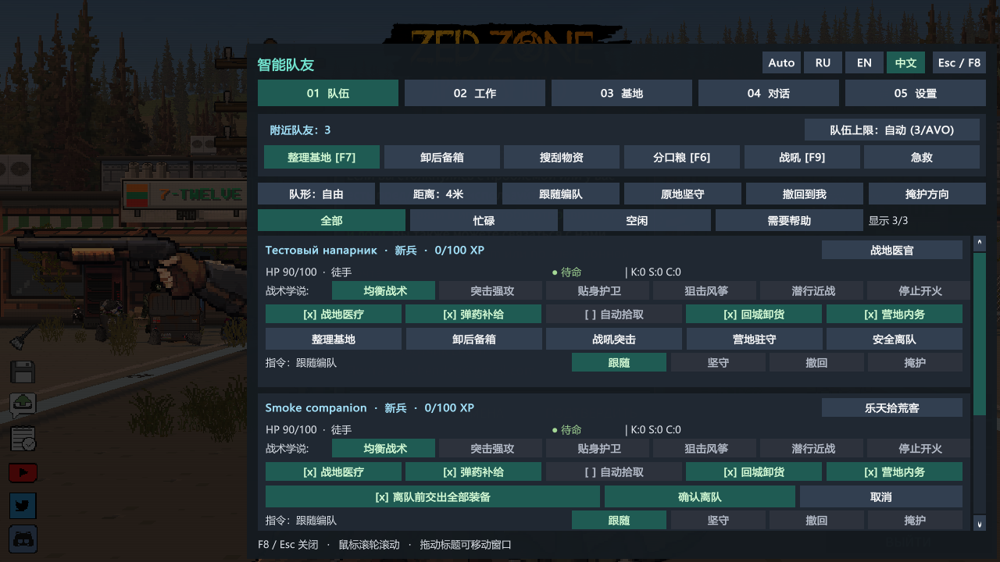
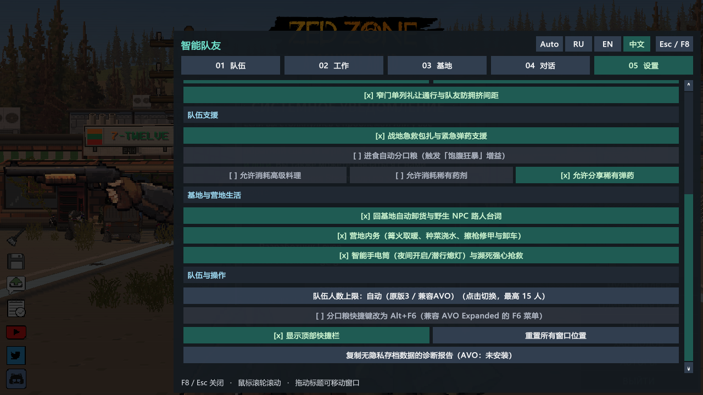
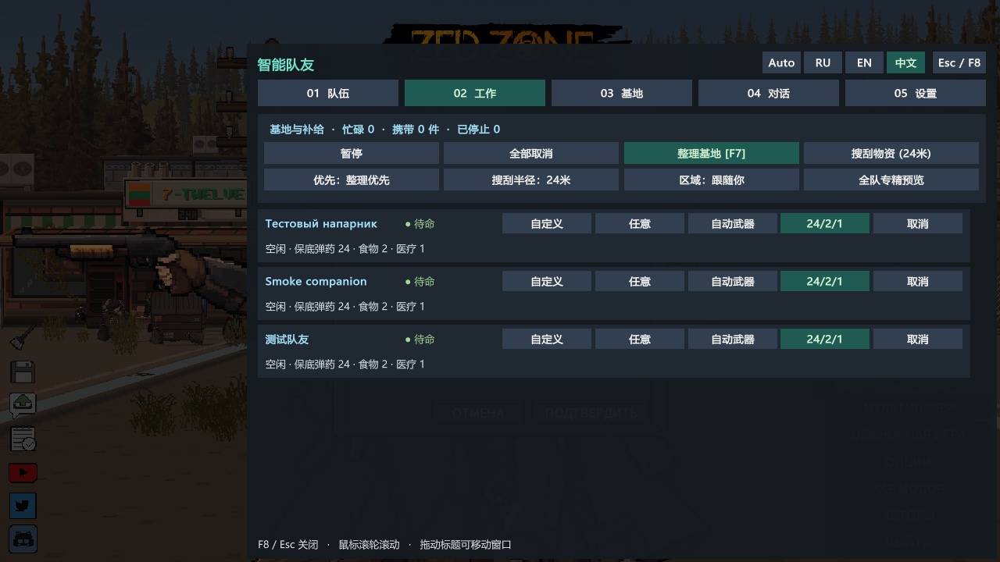
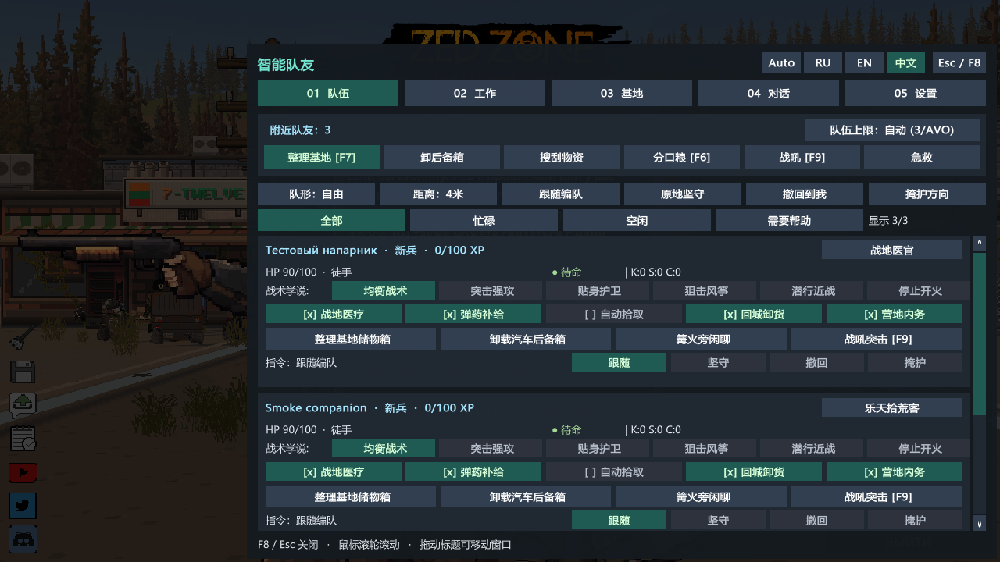
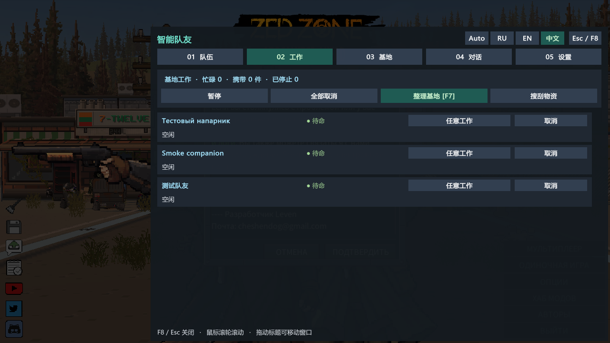
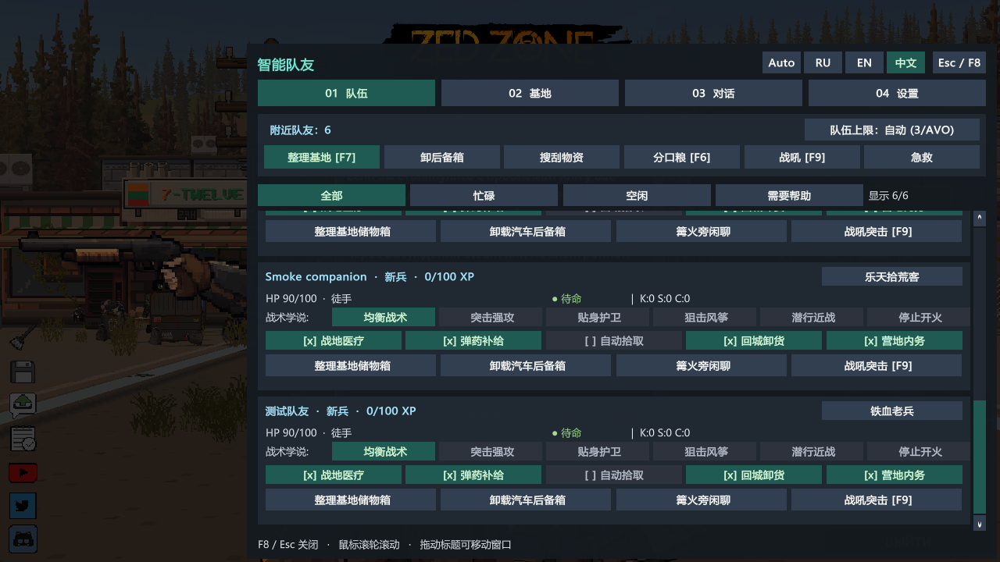
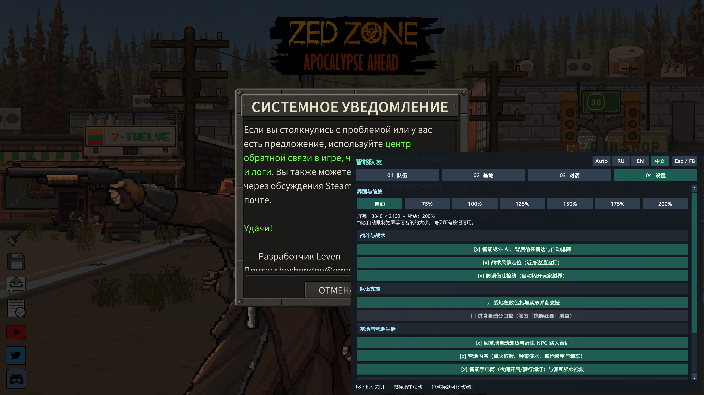

# ZED ZONE: Smart Companions — 智能队友、基地分类整理与 980+ 实时互动语录

<em>喜欢这个模组吗？欢迎在 <a href="https://boosty.to/lrgpp">Boosty</a> 上支持开发。</em>

  <a href="https://steamcommunity.com/sharedfiles/filedetails/?id=3836613312"><strong>Steam 创意工坊 (3836613312)</strong></a> ·
  <a href="https://github.com/druidqwerty/ZedZoneSmartCompanions/releases/tag/v2.4.0"><strong>下载 v2.4.0 发布包 (ZIP)</strong></a> ·
  <a href="README.md"><strong>English (README.md)</strong></a> ·
  <a href="README_RU.md"><strong>Русский (README_RU.md)</strong></a>

---

## v2.4.0 更新 — 营地驻守、安全离队交接与联机状态监测

- **营地驻守模式（`F8 → 队伍`与原生轮盘菜单）：** 让指定队友留在基地巡逻并执行仓管/种植工作，不再跟随外出远征。
- **两步确认安全离队（零物品瞬移）：** 离队前二次确认，可选让队友先走过去（`<= 2.45米`）将武器、护甲与背包物资交入基地储物箱或玩家手中。
- **联机同步健康栏（`F8 → 设置`与诊断报告）：** 直观显示网络模式、`SC14` 收发包数、冲突拦截次数与同步队友数量（不含隐私与坐标）。
- **已验证：** 实测战斗、搬运、战术、80箱压力、营地驻守与物理交接离队 + 300/300 图形测试；8,386 个存档文件均未改变。[测试范围与限制](docs/verification-2.4.0.md)。

## v2.3.0 更新 — 性能优化、15人规模与无隐私诊断

- **更轻量的搜索开销：** 帧级队友缓存、`O(1)` 物品分类记忆化、容器空间缓存与共享敌情快照，轻松应对 80+ 储物箱仓库与 15 人小队。
- **大型仓库与 15 人小队验证：** 实测 80 箱 / 960 件物品优先级路由仅需 `0.11 毫秒`，并验证 15 人全阵型无重叠与专精预览。
- **增强 AVO Expanded 兼容性：** 自动检测 AVO 插件与程序集，自动模式下保留 AVO 人数上限并启用 `Alt+F6` 避让，在设置中直观显示兼容状态。
- **一键无隐私诊断报告（`F8 → 设置`）：** 复制并保存故障排查摘要，**绝不包含**存档内容、角色姓名、Steam ID、系统路径或基地坐标。
- **已验证：** 游戏内实测战斗、物理搬运、战术、保底储备、20轮长稳循环、场景切换保护与联机重连恢复 + 300/300 个图形测试；8,386 个存档文件均未改变。[测试范围与限制](docs/verification-2.3.0.md)。

## v2.2.0 更新 — 队友专精与物资补给管理

- **队友专精（`F8 → 工作`）：** 战斗员、医疗兵、军需官、拾荒者预设，支持在应用至全队前打开**全队专精预览**查看变更统计。
- **武器偏好与背包保底储备：** 可选自动/远程/近战武器偏好及弹药/食物/医疗保底数量（`24/2/1`、`45/3/2`、`60/4/4`），整理基地时绝不清空保底物资。
- **稀有物资消耗权限（`F8 → 设置`）：** 独立控制是否允许消耗高级料理（如牛排）、稀有血清/血袋与稀有大口径弹药。
- **搜刮区域与基地优先级（`F8 → 工作`）：** 可调自动工作优先顺序（整理/搜刮/内务）、搜刮半径（`14–48米`）并固定搜刮区域（基地储物箱始终受保护）。
- **已验证：** 游戏内实测战斗、物理搬运、战术指令、真实 `ItemData` 保底储备与牛排保护；300/300 个图形测试；8,386 个存档文件均未改变。[测试范围与限制](docs/verification-2.2.0.md)。

## v2.1.0 更新 — 小队战术指挥

- **编队阵型与跟随距离：** 在 **F8 → 队伍**（或设置）中选择自由、楔形、横队、纵队或环形护卫，以及 2.5、4、6.5 或 9 米跟随距离，自动让开你的射界。
- **原地坚守、撤回到我与掩护方向：** 固定防线、跑步召回全队或优先迎击瞄准方向——支持全队、单人及原生 NPC 轮盘菜单。
- **窄门礼让与队友间距：** 后方队友在狭窄门口单列礼让，避免重叠拥挤。
- **受伤与缺弹撤退阈值：** 可设置生命值（关闭 / <25% / <30% / <50%）与弹药（关闭 / 弹尽 / <=5发）撤退规则，卡片实时显示当前指令与撤退/受阻原因。
- **已验证：** 游戏内实测战斗、物理搬运、原地坚守（0米偏移）、跑步撤回与方向掩护优先级；300/300 个图形测试；8,386 个存档文件均未改变。[测试范围与限制](docs/verification-2.1.0.md)。

## v2.0.0 更新 — 基地工作面板

- **新的“工作”标签页（F8 第二页）：** 每名队友的状态、当前工作、携带物品、剩余搜刮点及停工原因一目了然。
- **工作角色：** 任意工作、仓管、拾荒者、营地或不干活。角色只限制自动工作和全队指令；对单个队友的直接命令始终执行。
- **暂停 / 继续：** 队友保留当前工作和携带物品并跟随你；继续后完成剩余工作。直接下达整理或搜刮命令会结束暂停。
- **取消** 单个或全部工作；物品留在背包里，不会丢弃或瞬移。
- **联机：** 角色和暂停经主机校验的指令系统同步；他人队友仅可查看。
- **已验证：** 游戏内实测战斗、走位拾取与箱间搬运（搬运途中暂停4秒后继续，0次瞬移）；含新标签页的300/300个图形测试；8,386 个存档文件均未改变。[测试范围与限制](docs/verification-2.0.0.md)。

## v1.9.0 更新 — 更可靠的联机指令

- **主机校验每条指令：** 只有队友的所有者才能更改其战术学说或归属。
- **不再互相覆盖：** 同时修改时以先到者为准，主机随即广播真实状态，所有人看到一致的画面；所有者的快速连点按顺序生效。
- **他人队友仅可查看**（🔒 并显示所有者名称）。
- **1.8.x 与 1.9.0 混用仍可联机**；双方都更新才能获得完整保护。
- **已验证：** 游戏内联机决策表 13/13；270/270 个图形测试；8,386 个存档文件均未改变。真实双人联网会话尚未测试。[测试范围与限制](docs/verification-1.9.0.md)。

## v1.8.1 更新 — 一眼看清每名队友在做什么

- **卡片状态清晰：** 待命、忙碌、战斗中、已停止或需要帮助，以颜色区分。
- **停工原因：** 无法到达指定箱子、缺少空位或分类箱、没有已分类的箱子，或因战斗中断。
- **队伍筛选：** 全部、忙碌、空闲、需要帮助（HP低于50%、饥饿或口渴），并显示数量。
- **悬停提示：** 战术学说、队友开关、筛选和计数。
- **已验证：** 六种分辨率、三种语言共270/270个图形测试；8,386个存档文件均未改变。[测试范围与限制](docs/verification-1.8.1.md)。

## v1.8.0 更新 — 更清晰、适应屏幕的界面

- **四个独立 F8 标签页：** 小队、基地、语录与设置，分别管理战斗命令、储物规则、对话与偏好。
- **更易阅读：** 青绿色强调色、中性色背景、更大的文字与分组设置。
- **自动缩放：** F8 主窗口、HUD 与箱子分类面板使用统一缩放，按屏幕高度与可用空间适配，也适用于宽屏布局。
- **自行选择大小：** 在 **F8 → 设置 → 界面与缩放** 中选择自动或 75%、100%、125%、150%、175%、200%。实际缩放会限制在屏幕可容纳的范围内，界面显示最终百分比。
- **无需重启：** 改变分辨率或缩放时，面板重新定位到屏幕范围内。战斗机制与真实物品搬运保持不变。
- **储物控制更清晰：** 容器行高按名称换行调整，紧凑分类面板采用四列布局。打开 F8 时隐藏箱子面板，关闭主窗口会释放拖动与滚动捕获。
- **已验证：** 六种分辨率、三种语言的270个图形测试；75%/200%下的点击、滚动条按钮、拖动和关闭。[测试范围与限制](docs/verification-1.8.0.md)。自动注入滚轮事件及真实双人NPC可见性仍未验证。

## v1.7.0 更新 — 真实走位拾取与箱间搬运（彻底移除隔空传物）

- **地面、尸体与野生容器真实走位搜刮 (`AutoLootSystem_JobRunner.cs`, `AutoLootSystem_Transfer.cs`, `PhysicalMovementHelper.cs`)：**
  - 移除所有瞬间隔空吸物逻辑。下达搜刮指令或自动拾取时，队友会建立按距离排序的 `LootQueue`，使用带避障的原生 A* 寻路 (`agent.MoveTo` + 基于碰撞体外缘的 `ComputeSurfaceDistance`) 逐一走到每个目标旁，在 `<= 2.45m` 触手可及范围内短暂交互停顿 (`0.35s`) 后才将物品收入背包。
- **基地储物箱真实走位搬运整理 (`F7`, `BaseSortingSystem_Worker.cs`, `BaseSortingSystem_PhysicalCarry.cs`)：**
  - 移除一键瞬间整理按钮 (`⚡ 立即秒理`)。队友会先走到收货箱/源箱旁 (`SortingPhase = 1`) 取出物品放入 `CarryBuffer`，再亲自走到对应分类箱旁 (`SortingPhase = 2`) 将物品存入。
- **战斗中断零瞬移保护 (`BaseSortingSystem_CarryOps.cs`, `BaseChoreSystem.cs`)：**
  - 若搬运途中突发战斗或目标箱不可达，`ReturnCarryBufferWithoutTeleport` 会将搬运中的物品直接留在队友背包中（满包则放在脚下），绝不隔空传回原箱。
- **引擎实测验证：** 已通过真实 ZED ZONE 引擎全部 6 阶段验收（`57` 个 Harmony 补丁、`[SelfVerify] PASS v1.7.0`、阶段 0–3 丧尸/强盗射击与停火测试 `PASS`、阶段 A 地面拾取走位 `6.77m` `PASS`、阶段 B 储物箱搬运走位 `1.64m` `PASS`、`0` 次隔空瞬移，`8,386` 个存档文件哈希完全一致）；详见[验证报告](docs/verification-1.7.0.md)。

## v1.6.0 更新 — 全面源码审查重构、装备与联机玩偶保护及严格停火修复

- **修正原生 `MonsterAttr` ID 并保护玩家数据 (`0 = 玩家`, `200 = 强盗`, `201 = 幸存者`, `202 = 改造安保队员`)：**
  - 将强盗 ID 从错误的 `202` 修正为 `200`，新增本地与远程联机玩家保护 (`IsAnyPlayerCharacterData`)，自动修复旧存档中被误设为 `202` 的普通幸存者，且仅对 `200 (强盗)` 配置仇恨范围。
- **全面加固远程/近战武器初始化与手部动画 (`HumanNpcEquipmentGuard`) + 主机活跃 NPC 漏注册救援：**
  - 无论是否处于联机模式，均保护所有非本地玩家人类角色（队友、野生 NPC、客户端玩偶与远程玩家玩偶），自动补全底层 `InventoryData`，防止损坏武器中断 `Init()` 与 `GameController.AddCharacter()`，并在 `UpdateHand_RangedWeapon` 中校验全部骨骼引用（`Player.log` 武器/手部空引用降至 `0`）。
- **战斗 AI、严格执行停火令 (`StopFire` / `Passive`)、清理幽灵仇恨与聊天输入防误触：**
  - 全姿态清零友方/中立人类仇恨值，在 `StopFire` / `Passive` 下严格屏蔽 `GOAPGoal_EliminateThreat`，自动清理区块卸载残留目标，修复野生小队误判与营地居民误报偷袭，新增 `NPC_DISMISS` 与 `AutoCompact` 联机同步，并在聊天打字时屏蔽 `F6–F9`（支持 `Esc` 关闭 `F8`）。
- **验证与联机说明：** 已通过真实 ZED ZONE 引擎全流程验收（`55` 个 Harmony 补丁、`[SelfVerify] PASS v1.6.0`、丧尸/强盗射击与停火测试全部 `PASS`，`8,383` 个存档文件哈希完全一致）。真实双人联机世界（主机 + 客户端）中的人类 NPC 可见性仍有待双人实测确认；详见[验证报告](docs/verification-1.6.0.md)。

## v1.5.0 更新 — 修复解雇队友不离队、窗口自由拖拽、队伍上限提升（最高15人）、兼容 AVO 与自主搜刮修复

- **修复队友解雇后仍跟着玩家不离队的问题 (`QuitTeam` / `RemoveTeamNPC`)：**
  - 修复 `MultiplayerSyncSystem.SyncCompanionOwnerAndLeader` 在队友离队后自动写回 `leaderCharacterGUID` 导致左上角头像消失但队友仍尾随玩家的 Bug。
- **界面支持鼠标自由拖拽 + 默认位置避开小地图与背包整理按键：**
  - 主窗口 (`F8`)、箱子分类栏（展开与收起状态）以及顶部快捷栏均支持按住 `::` 标题自由拖拽并自动保存位置（第 3 页设置可一键重置窗口位置）。
  - 顶部快捷栏默认移至左上方居中区域（支持 `[-]` 收起为迷你 `F8` 按钮或 `[x]` 隐藏），不再遮挡右上角小地图；箱子分类栏默认移至屏幕下方居中，不再遮挡背包整理按钮。
- **可调队伍人数上限（最高 15 人）与 `AVO Expanded` 完整兼容：**
  - 在第 1 页与第 3 页新增队伍上限切换按钮（`自动(原版3/兼容AVO)`、`4`、`6`、`8`、`10`、`12`、`15` 人）。
  - 自动检测并兼容 `AVO Expanded — Advanced Squad Control` (`3836458339`)：将分口粮快捷键切换为 `Alt + F6`，按 `F6` 打开 AVO 菜单时不再误吃背包食物。
- **修复「收集物资 (`CollectResource`)」指令原地跟人不搜刮的问题：**
  - 处于收集物资指令时，跟随优先级在 `42米` 内保持低位（不再在 12米 被拉回），解除未开箱搜刮限制，同时严格保护玩家标记的基地箱子不被队友拿走。[验证报告](docs/verification-1.5.0.md)。

## v1.4.2 更新 — 修复自动分类全变医疗品、仅整理玩家标记箱子与零丢失紧凑整理

- **修复自动识别分类全部变成「医疗品」的问题 (`ItemCategorizer.HasFeature`)：**
  - 修复原生 `ItemAttr.GetItemFeatureByFeatureType` 返回全局非空特性导致所有物品被误判为医疗品的问题，现在武器、弹药、材料、工具、服装、食品与医疗品均可准确识别。
- **仅整理玩家亲自标记的基地箱子 (`IsMarkedByPlayer`) 与 F8 三档智能筛选：**
  - 队友现在**仅**在你标记为基地储物箱 (`[*]`) 的箱子之间搬运物资，绝不会把物品搬到外面的野生箱子中；F8 默认开启「已标记 + 脚边 (≤2米)」筛选，告别满屏无关箱子。
- **防溢出安全整理 (`TryAutoSortingWithoutOverflow`) 与收货箱完整卸载：**
  - 使用带快照回滚的 `TryAutoSortingWithoutOverflow` 替代 `AutoSorting(false, ...)`，彻底杜绝整理时物品消失；支持同类堆叠合并，并在收货箱有剩余物品时明确提示缺少空位或分类箱的类别。[验证报告](docs/verification-1.4.2.md)。

## v1.4.1 更新 — 自动发现周围全部箱子、独立箱子配置与真实走位搬运

- **无需先打开箱子即可识别周围全部储物箱 (`CollectWorldTerrainObjects`)：**
  - 扫描当前加载区块 (`MapController.instance.currentChunkList`)、建筑物楼层 (`BasicBuilding.ActiveObjects`) 与地面部署容器 (`BasicItem.ActiveObjects`)，按 **F8** 自动选中你身边最近的箱子并显示坐标 `[x,y]`。
- **修复所有箱子共用收货中转箱/分类的问题：**
  - 每个箱子拥有完全独立的唯一 ID (`box_{rx100}_{ry100}_{z}_{attrId}_{standVz}_{guid}`)，设置中转箱或分类互不干扰。
- **队友真实走位搬运与隐藏搬运缓存 (`CarryBuffer`)：**
  - 队友整理仓库 (`F7`) 时不再隔空瞬移物品，而是亲自走到源箱子旁将物品取出放入独立的 **隐藏搬运空间 (`CarryBuffer`)**（不占用队友主背包与武器栏），再走到各个分类箱旁依次存入；若遇敌或退出游戏会自动安全归还物品，绝不丢失。[验证报告](docs/verification-1.4.1.md)。

## v1.4.0 更新 — 联机多人同步与人类敌对 NPC 射击修复

- **完整联机多人同步 (`MultiplayerSyncSystem`)：**
  - **基地储物箱分类实时同步：**当联机好友为箱子设置分类、收货中转箱或优先级时，主机与客户端自动同步（通过 `TerrainObjectData` 属性与静默同步包），双方看到完全一致的箱子分类。
  - **队友归属权与跨玩家急救：**联机中每位玩家拥有并指挥自己的专属队友（`F8` 显示归属标签），但好友的队友可以在战斗中为你包扎急救与解围，反之亦然。
- **修复联机 Bug 1（打开箱子弹出点火菜单）：**修复基地内务自动生火调用 `IgnitionFire(true)` 导致好友开箱时主机弹出点火工具选择界面的问题（改为直接调用 `OnIgnite()`）。
- **修复联机 Bug 2（客户端看不见 NPC）：**修复人类 NPC 因 `characterAttrId = 0` 被 `NetMonsterSync.SpawnPuppet` 丢弃以及客户端 `spriteParent` 未激活导致看不见 NPC 的问题。
- **修复战斗 Bug 3（队友不向敌对人类 NPC 开枪）：**修复原版 `UpdateAgentSight` 因 `(21 % 10) == (1 % 10)` 将强盗（阵营 21）误判为友军（阵营 1）、`GOAPGoal_WarningHumanEnemy` 阻塞射击以及人类威胁值缺失的问题，队友现在能像射击丧尸一样立即向敌对人类 NPC 开火。[验证报告](docs/verification-1.4.0.md)。

## v1.3.2 修复

- **游戏原生队友指令菜单：**修复空白分类和指令名称，保留原版指令。这与 1.3.1 的 F8 窗口修复不同。
- **威胁反应：**修复已存储的战斗与武器偏好指令，每 0.3 秒刷新威胁感知，仍受武器射程和原生视线检查限制；不会强制穿墙开火，也不会覆盖停止开火命令。
- **减少战斗干扰：**发现威胁时暂停物资整理；只有玩家瞄准时才避让射界；减少风筝移动对开火的打断。
- **拾取与背包：**以队友位置搜索物资；仅在目标背包能完整容纳时转移物品；经验会在晋级之间保存，合并频繁写入并在退出时完成最后一次保存。
- **口粮：**手动分享为每位获食队友消耗一个食物物品，每位队友分别有 30 秒冷却；自动分享使用玩家已经吃掉的食物。
- 无需重置存档，本次不增加台词。安装时关闭游戏一次，之后设置仍可即时调整。[测试记录与限制](docs/verification-1.3.2.md)。

## v1.3.1 修复

- 修复 F8 队友卡片、基地储物箱与设置页面的空白内容。
- 检查字体是否支持中文和俄文字形，避免方框；按钮中的不支持表情改为文字。
- 点击 F8 窗口或模组面板时不再触发角色攻击，包括关闭窗口的一次点击。
- 界面异常保留调用堆栈，不再刷屏。无需重置存档。
- [测试记录与限制](docs/verification-1.3.1.md)。

**ZED ZONE: Smart Companions（智能队友与基地物流中心）** 是一款基于 **BepInEx 6 (IL2CPP)** 的《ZED ZONE》代码模组，彻底升级你招募的幸存者队友：提供针对丧尸与人类匪徒的智能战术战斗 AI、带 **12 大物资分类** 的基地储物箱自动分拣系统、**60 个情景话题共 1,179 条三语实时气泡台词（其中包含 324 条中文台词：190 条末日粗口 18+ 与 134 条纯净台词）**、6 种战术学说、战地急救与弹药支援，以及 **语言自动识别与游戏内一键切换（🌐 自动 / 🇷🇺 Русский / 🇬🇧 English / 🇨🇳 简体中文）**。

## v1.3.0 更新亮点

- **完整简体中文支持 + 自动语言识别与手动切换 (`ModLanguage.Auto / Russian / English / Chinese`)：**
  - 默认处于 **🌐 自动 (`Auto`)** 模式：自动读取《ZED ZONE》游戏语言 (`GameController.instance.gameSettings.languageCode`) 或系统语言 (`Application.systemLanguage`)，当游戏设置为中文时自动切换为简体中文界面与中文气泡台词。
  - 在 **F8** 主窗口顶部标题栏与第 3 页设置面板中，均可随时点击 **🌐 Авто/Auto/自动 · 🇷🇺 Русский · 🇬🇧 English · 🇨🇳 简体中文** 立即切换语言，无需重启游戏（自动保存在 `BepInEx/config/SmartCompanions_Rules.txt` 与 `SmartCompanionsConfig.json` 中）。
  - 动态加载支持中日韩与西里尔字符的系统字体 (`Microsoft YaHei`, `Segoe UI`, `SimHei`, `Arial`)，确保中文 UI 与气泡清晰显示。
- **50 个情景话题全部汉化（263 条独特中文台词：159 条末日粗口 18+ / 104 条纯净版）：**
  - 包含吃独食牛排吐槽（*“好吃吗你他妈的？！自己一个人偷吃牛排，老子连肉味都没闻过！”* / *“一定很好吃吧？是吧？我以前还从来没尝过真正的牛排呢……”*）、生肉/罐头/鱼排/汽水/啤酒反应、包扎/装弹/修装备/烧烤/撬锁吐槽、遭遇尸潮/强盗/巨型变异体喊话、让开玩家枪线、枪械卡壳排障、背后偷袭雷达预警、战地急救与递弹药、分享口粮 (`F6`) 感谢、基地搬箱子发牢骚、背包超重吐槽、天气（大雨/血雨/昼夜）以及队友互怼与路人 NPC 台词。

## 核心功能

1. **智能战斗 AI (`SmartCombatAI`)：** 贴身保护玩家后背、人类枪手横向走位、巨型 Boss 保持距离、风筝后撤步射击、自动闪开玩家瞄准火线（防误伤走廊）、近身空仓自动拔刀、背后偷袭雷达预警、自动排障清卡壳。
2. **基地储物箱 12 分类自动整理 (`BaseSortingSystem`)：** 打开任意非玩家储物箱时屏幕上方自动显示 **12 分类栏**（近战武器、枪械与配件、弹药与弹匣、医疗与急救、生鲜与熟食、罐头与饮品、制作材料、工具与维修、服装与背包、载具与电力、农艺与宠物、爆炸物与杂项）与 **📥 收货中转箱** 开关。按 **F7** 命令队友将战利品按类别归位并自动紧凑排列 (`AutoSortMode.Dense`)；回基地脱战靠近箱子时还会自动卸货。
3. **分享口粮与「🔥 饱腹狂暴」增益 (`F6`)：** 按 **F6**（或在设置中开启进食自动分口粮）向小队分享食物，恢复队友饱食/饮水/精力并赋予 3 分钟 **「饱腹狂暴」** 战斗增益。
4. **6 种战术学说与原生右键菜单集成 (`F8` + `NPCCommandMenu`)：** 均衡战术、突击强攻、贴身护卫、狙击风筝、潜行近战、停止开火，全部集成至游戏原生队友环形菜单。

## 安装与快捷键

1. 订阅必需的第三方依赖 **[ZED ZONE Code Mod Loader (BepInEx IL2CPP)](https://steamcommunity.com/sharedfiles/filedetails/?id=3834614258)**（创意工坊 ID `3834614258`，并非 druidqwerty 制作的模组），运行一次其中的 `install.cmd`。
2. 订阅本模组 **[ZED ZONE: Smart Companions](https://steamcommunity.com/sharedfiles/filedetails/?id=3836613312)**（或将 `ZedZoneSmartCompanions-2.4.0.zip` 解压至 `<ZED ZONE>`）。
3. 快捷键：**`F8`** 打开三页智能队友与基地中心 · **`F7`** 命令整理基地储物箱 · **`F6`** 向小队分享口粮。

© 2026 druidqwerty. 基于 MIT 许可证开源发布。免费开源模组；AI 辅助代码编写，由 druid 设计与测试。
