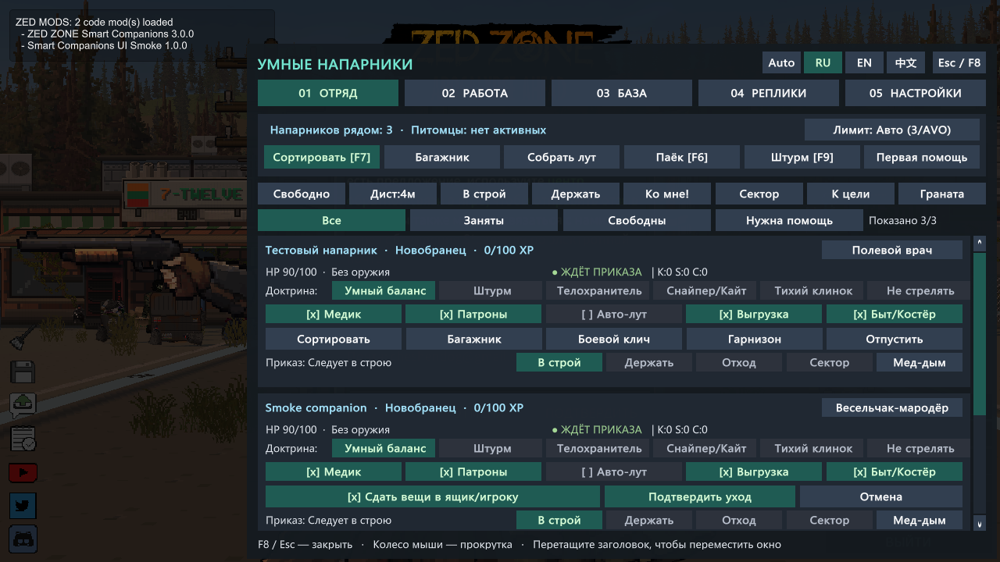
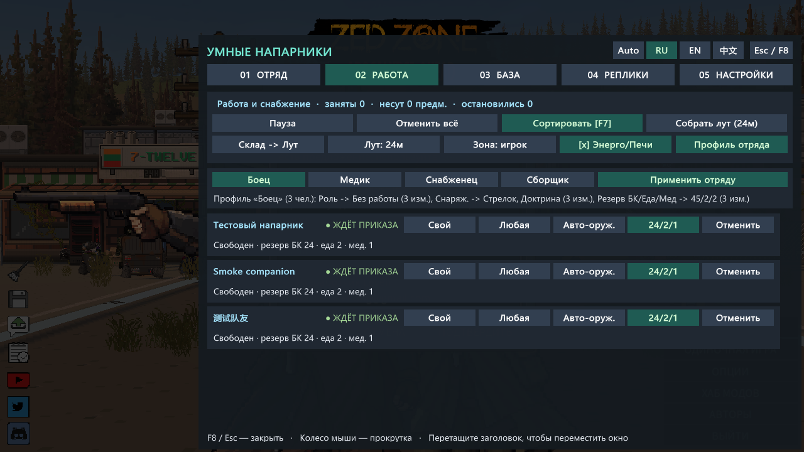
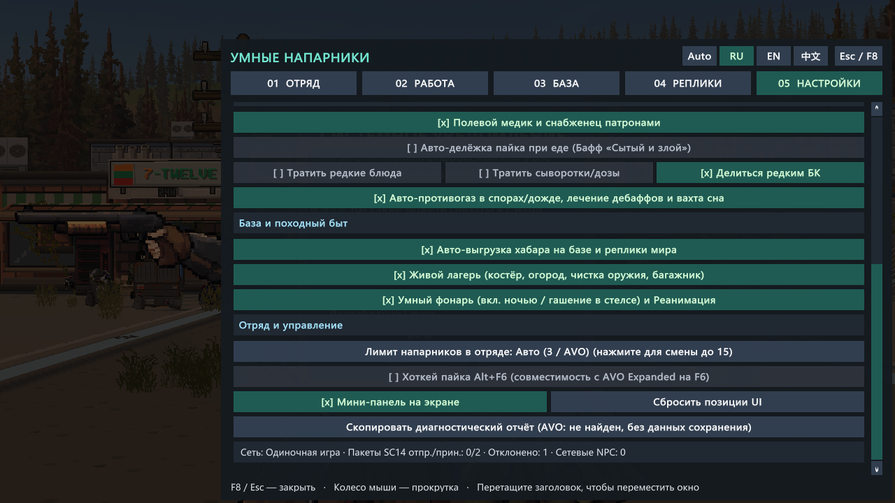
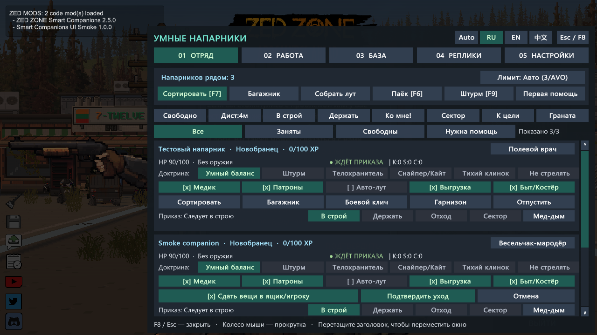
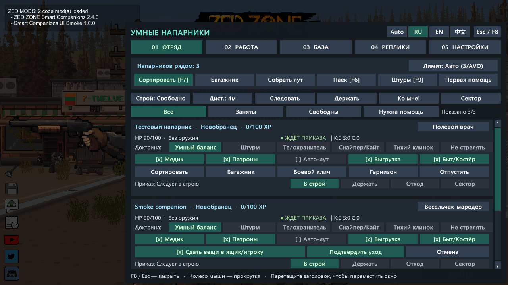
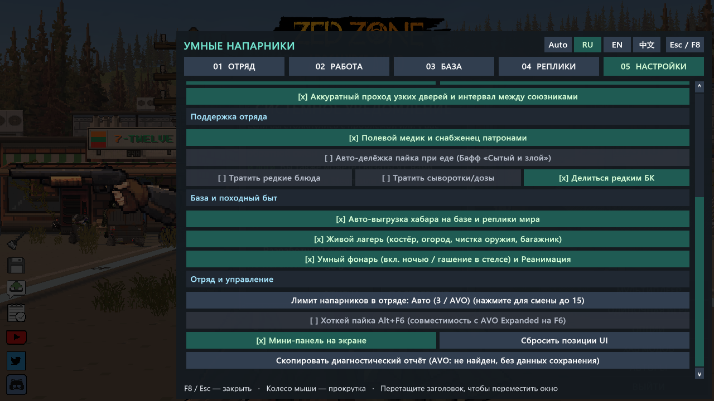
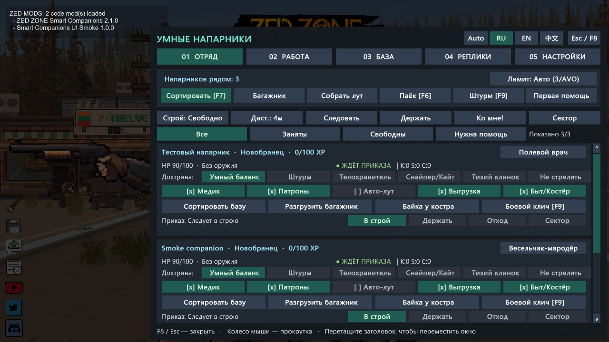
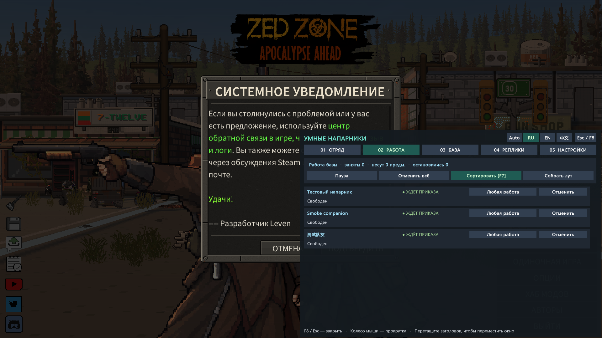
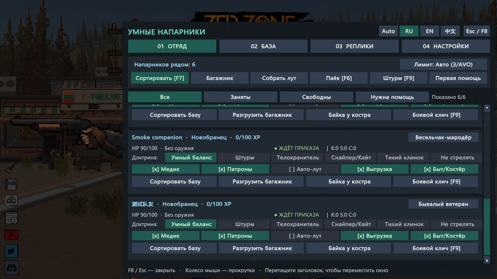
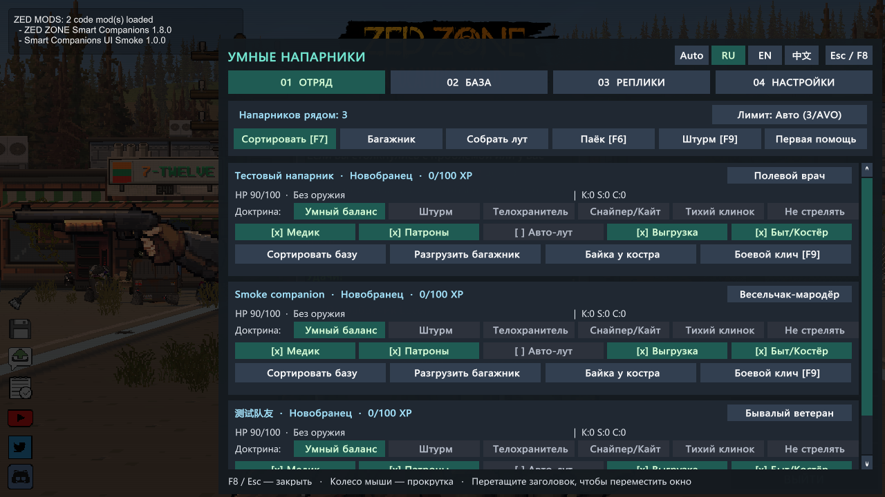

# ZED ZONE: Smart Companions — Умные напарники, сортировка базы и живые фразы

<em>Нравится мод? Поддержите его развитие на <a href="https://boosty.to/lrgpp">Boosty</a>.</em>

  <a href="https://steamcommunity.com/sharedfiles/filedetails/?id=3836613312"><strong>Steam Workshop (3836613312)</strong></a> ·
  <a href="https://github.com/druidqwerty/ZedZoneSmartCompanions/releases/tag/v3.0.0"><strong>Скачать релиз v3.0.0 (ZIP)</strong></a> ·
  <a href="README.md"><strong>English Documentation (README.md)</strong></a> ·
  <a href="README_CN.md"><strong>简体中文文档 (README_CN.md)</strong></a>

---

## Новое в v3.0.0 — Рубеж «Экспедиции»: экипажи транспорта, бункеры/этажи (zLevel) и питомцы

- **Экипажи транспорта и переполнение мест (`BasicVehicle`):** при посадке за руль раненые, медики и бойцы получают приоритет мест (`PlanVehicleSeatAllocation`), а лишние бойцы большого отряда аккуратно остаются в гарнизоне/ожидании без толкотни у дверей; снабженцы физически подходят к авто (`<= 2.45 м`) для ухода за кузовом.
- **Межэтажная навигация и бункеры (`TerrainObject_Door_UndergroundEntrance`, `DugShaft`, `zLevel`):** напарники сами находят ближайший люк или лестницу на своём этаже, подходят ногами (`<= 2.15 м`, без телепортации сквозь потолок!) и синхронно переходят на нужный уровень `zLevel`.
- **Связка с питомцами (`PetSystem`, `F8 → Отряд`):** сводка активных питомцев в шапке вкладки **Отряд**, помощь при посадке в авто, полная защита от дружественного огня и физическая подкормка голодных питомцев.
- **Проверено:** полный живой прогон в игре + 300/300 графических случаев + все 9 пакетов детерминированных проверок; все 8 386 файлов сохранений без изменений. [Отчёт и границы](docs/verification-3.0.0.md).

## Новое в v2.7.0 — Индустриальная база и энергетика (0 телепортаций)

- **Генераторы, обогрев и зарядка батарей (`F8 → Работа`):** напарники физически носят топливо со склада в `StirlingGenerator` и обогреватели (`<= 2.45 м`) и меняют аккумуляторы в `BatteryCharger`.
- **Печи и полевая кухня:** выгрузка готовых слитков, угля и приготовленных блюд из печей и плит по профильным ящикам базы.
- **Жёсткий белый список топлива (`IsApprovedStationFuelItem`):** полный запрет на сжигание оружия, брони, одежды, медицины, еды, книг, денег, досок, батарей и редких деталей.
- **Проверено:** живой бой, переноска, гарнизон, безопасный отпуск, `GrenadeSafetyGate`, биозащита и фильтр топлива + 300/300 графических случаев; все 8 386 файлов сохранений без изменений. [Отчёт и границы](docs/verification-2.7.0.md).

## Новое в v2.6.0 — Автономное выживание: противогазы, дебаффы и вахта сна

- **Авто-противогазы в спорах и кровавом дожде (`GOAPAction_EquipFaceMask`):** напарники сами надевают защиту дыхания, берегут обычную маску от сдачи на склад и возвращают её на чистом воздухе.
- **Лечение опасных состояний (`GOAPAction_ClearDebuff_*`):** помощь при горении, лихорадке, гипотермии и спорах с приоритетом обычных средств и защитой редких сывороток.
- **Посменный сон с часовым (`GOAPAction_Sleep`):** уставшие бойцы физически подходят к кроватям базы по очереди — минимум один дозорный всегда бодрствует, а тревога мгновенно будит спящих.
- **Проверено:** живой бой, переноска, гарнизон, безопасный отпуск, `GrenadeSafetyGate` и защита обычной маски в живой игре + 300/300 графических случаев; все 8 386 файлов сохранений без изменений. [Отчёт и границы](docs/verification-2.6.0.md).

## Новое в v2.5.0 — Полевая тактика 2.0: приказ по курсору, укрытия, гранаты и эвакуация

- **Веерный приказ по курсору (`Alt+G`, `F8 → Отряд → К цели` и радиальное меню):** отправляйте бойца или весь отряд веером (`>= 1.25 м`) точно в точку под курсором мыши.
- **Умные укрытия под обстрелом (`GOAPAction_TakeCover`):** напарники автоматически уходят за укрытия в перестрелках с вооружёнными мародёрами.
- **Безопасные гранаты с `GrenadeSafetyGate` (`F8 → Отряд → Граната`):** бросок только по скоплению `>= 3` врагов или боссу с жёсткой блокировкой в радиусе `6.5 м` от своих/питомцев и `18.0 м` от ящиков базы.
- **Лечебный дым и спасение раненых (`Alt+H`, кнопка `Мед-дым` и радиальное меню):** прицельный мед-дым, перевязка и автоматическое спасение тяжелораненых (`< 32% HP`) медиками.
- **Проверено:** живой бой, переноска, гарнизон, безопасный отпуск и живая проверка `GrenadeSafetyGate` + 300/300 графических случаев; все 8 386 файлов сохранений без изменений. [Отчёт и границы](docs/verification-2.5.0.md).

## Новое в v2.4.0 — Гарнизон базы, безопасный отпуск и телеметрия кооператива

- **Режим «Гарнизон базы» (`F8 → Отряд` и радиальное меню):** оставляйте выбранных бойцов охранять периметр лагеря и работать на складе и огороде, не уводя их в дальние рейды.
- **Безопасный двухшаговый отпуск (`0` телепортаций):** подтверждение перед увольнением с опцией физического подхода к ящику базы или к игроку (`<= 2.45 м`) для аккуратной сдачи оружия, брони и рюкзака.
- **Индикатор синхронизации кооператива (`F8 → Настройки` и Диагностика):** режим сети, пакеты `SC14`, отклонённые чужие правки и число синхронизированных NPC без личных данных и координат.
- **Проверено:** живой бой, переноска, тактика, склад на 80 ящиков, удержание гарнизона при уходе игрока на 12 м и физическая сдача снаряжения при отпуске + 300/300 графических случаев; все 8 386 файлов сохранений без изменений. [Отчёт и границы](docs/verification-2.4.0.md).

## Новое в v2.3.0 — Производительность, отряды до 15 чел. и диагностика

- **Быстрый поиск предметов, ящиков и целей:** кэш отряда на кадр, `O(1)` кэширование категорий предметов, пространственный кэш контейнеров и общий срез угроз для складов на 80+ ящиков и отрядов до 15 человек.
- **Большие склады и отряды до 15 бойцов:** проверена маршрутизация по приоритетам на складе из 80 ящиков / 960 предметов (`0.11 мс` в живом движке), а также построения и предпросмотр профилей для 15 человек.
- **Совместимость с AVO Expanded:** определение AVO через реестр плагинов BepInEx IL2CPP и сборки, сохранение лимита AVO в режиме `Авто`, авто-защита `F6` через `Alt+F6` и индикатор статуса AVO в Настройках.
- **Диагностический отчёт в один клик (`F8 → Настройки`):** копирует сводку в буфер обмена и сохраняет `SmartCompanions_Diagnostics.txt` **без** данных сохранения, имён, Steam ID, личных путей и координат.
- **Проверено:** живой бой, физическая переноска, тактика, резервы, 20-цикловый прогон, переходы локаций и реконнект кооператива + 300/300 графических случаев; все 8 386 файлов сохранений без изменений. [Отчёт и границы](docs/verification-2.3.0.md).

## Новое в v2.2.0 — Специализация напарников и снабжение

- **Профили напарников (`F8 → Работа`):** Боец, Медик, Снабженец и Сборщик для каждого бойца, а также **предпросмотр изменений** перед применением профиля сразу ко всему отряду.
- **Предпочтительное оружие и неснижаемый резерв:** выбор Авто-оруж. / Стрелок / Ближний и неснижаемый запас в рюкзаке (`24/2/1`, `45/3/2`, `60/4/4` — патроны / еда / медицина), который не выгружается при сортировке базы.
- **Разрешения на редкие припасы (`F8 → Настройки`):** отдельные переключатели для защиты стейков, редких сывороток/доз и редких калибров БК при раздаче пайка и лечении.
- **Зоны лута и приоритеты базы (`F8 → Работа`):** очередь задач (Склад / Лут / Лагерь), радиус поиска (`14–48 м`) и закрепление точки сбора без риска для ящиков базы.
- **Проверено:** живой бой, физическая переноска, тактика, защита резерва на настоящих `ItemData` и защита редких стейков в игре; 300/300 графических случаев; все 8 386 файлов сохранений без изменений. [Отчёт и границы](docs/verification-2.2.0.md).

## Новое в v2.1.0 — Тактическое управление отрядом

- **Построения и дистанция следования:** выбирайте Свободно, Клин, Шеренгу, Колонну или Круг и дистанцию 2.5, 4, 6.5 или 9 м прямо во вкладке **F8 → Отряд** (или в Настройках).
- **Держать позицию, Ко мне! и Прикрывать сектор:** закрепляйте бойцов на точке, бегом отзывайте их к своей позиции или назначайте приоритетный сектор огня — всему отряду, одному напарнику или через радиальное меню NPC.
- **Узкие проходы и интервал союзников:** идущие сзади уступают узкие двери в колонну по одному и не сбиваются в кучу.
- **Пороги отхода при ранении и без БК:** настраивайте порог здоровья (`Выкл / <25% / <30% / <50%`) и патронов (`Выкл / 0 патр. / <=5 патр.`) с наглядной причиной на карточке каждого напарника.
- **Проверено:** живой бой, физическая переноска, удержание позиции (0 м смещения), пробежка «Ко мне!» и приоритет сектора в настоящей игре; 300/300 графических случаев; все 8 386 файлов сохранений без изменений. [Отчёт и границы](docs/verification-2.1.0.md).

## Новое в v2.0.0 — Доска работ базы

- **Новая вкладка «РАБОТА» (F8, вторая):** состояние каждого напарника, текущее дело, вещи в руках, оставшиеся точки лута и причина остановки — на одной доске.
- **Роли:** Любая работа, Кладовщик, Сборщик, Лагерь или Без работы. Роль ограничивает автоматическую работу и приказы всему отряду; прямой приказ конкретному напарнику выполняется всегда.
- **Пауза / продолжить:** напарники сохраняют дело и вещи и идут за вами; после продолжения доделывают. Прямой приказ сортировки или сбора лута снимает паузу.
- **Отмена** одного дела или всех; вещи остаются в рюкзаке. Ничего не выбрасывается и не телепортируется.
- **Кооператив:** роли и пауза проходят через систему приказов с проверкой хостом; чужие напарники — только просмотр.
- **Проверено:** живой бой, физический лут и переноска между ящиками с паузой на 4 секунды посреди переноски (0 телепортаций) в настоящей игре; 300/300 графических случаев с новой вкладкой; все 8 386 файлов сохранений не изменились. [Отчёт и границы](docs/verification-2.0.0.md).

## Новое в v1.9.0 — Надёжные приказы в кооперативе

- **Каждый приказ проверяет хост:** менять доктрину или владельца напарника может только его владелец.
- **Нет перетягивания:** при одновременных изменениях побеждает первое, а хост рассылает настоящее состояние — у всех одинаковая картина. Быстрые клики владельца применяются по порядку.
- **Только просмотр** для напарников другого игрока (🔒 и имя владельца).
- **Смешанные сессии 1.8.x/1.9.0 работают**; для полной защиты обновитесь оба.
- **Проверено:** таблица решений кооператива 13/13 в настоящей игре; 270/270 графических случаев; все 8 386 файлов сохранений не изменились. Настоящая сетевая сессия вдвоём пока не проверена. [Отчёт и границы](docs/verification-1.9.0.md).

## Новое в v1.8.1 — Видно, чем занят каждый напарник

- **Понятный статус на карточке:** Ждёт приказа, Занят, В бою, Остановлен или Нужна помощь — цветом.
- **Почему работа остановилась:** нет пути к названному ящику, нет места или ящика для категорий, нет ящиков с категориями, помешал бой.
- **Фильтры отряда:** Все, Заняты, Свободны и Нужна помощь (HP ниже 50%, голод или жажда) со счётчиком.
- **Подсказки при наведении** для доктрин, переключателей, фильтров и счётчиков.
- **Проверено:** 270/270 графических случаев на шести разрешениях и трёх языках; все 8 386 файлов сохранений не изменились. [Отчёт и границы проверки](docs/verification-1.8.1.md).

## Новое в v1.8.0 — Понятный интерфейс под ваш экран

- **Четыре вкладки F8:** «Отряд», «База», «Реплики» и «Настройки». Боевые приказы, правила хранения, диалоги и параметры теперь разделены.
- **Лучше читается:** обновлённое оформление с бирюзовыми акцентами, более крупный текст и сгруппированные настройки.
- **Автомасштабирование:** окно F8, мини-панель и категории ящика используют единый масштаб по высоте экрана и свободному месту, в том числе на широкоформатных экранах.
- **Размер на ваш вкус:** Авто или 75%, 100%, 125%, 150%, 175%, 200% в **F8 → Настройки → Интерфейс и масштаб**. Масштаб ограничивается размером экрана, чтобы окно помещалось целиком; рядом показан фактический процент.
- **Без перезапуска:** при смене разрешения или масштаба панели возвращаются в границы экрана. Боевые механики и физическая переноска предметов не изменены.
- **Удобнее работать с ящиками:** высота строк учитывает перенос названий, компактные категории размещены в четыре столбца. Панель ящика скрыта при открытом F8, а закрытие окна освобождает захват перетаскивания и прокрутки.
- **Проверено:** 270 графических случаев на шести разрешениях и трёх языках; клики, кнопки прокрутки, перетаскивание и закрытие при 75%/200%. [Отчёт и границы проверки](docs/verification-1.8.0.md), включая неподтверждённую автоматическую подачу колеса. Видимость людей-NPC в парном кооперативе ещё не подтверждена.

## Новое в v1.7.0 — Реальный обход и переноска лута и ящиков ногами (без телепортации предметов)

- **Честный физический сбор лута с земли, трупов и диких ящиков (`AutoLootSystem_JobRunner.cs`, `AutoLootSystem_Transfer.cs`, `PhysicalMovementHelper.cs`):**
  - Полностью убран мгновенный дистанционный сбор. По приказу собрать трофеи (и при авто-луте) напарники строят очередь целей (`LootQueue`), подходят к каждому предмету, трупу или ящику с обходом препятствий по нативному A* (`agent.MoveTo` + расчёт дистанции до внешней грани коллайдера `ComputeSurfaceDistance`), делают короткую паузу (`0.35 с`) на дистанции вытянутой руки (`<= 2.45 м`) и только после подхода забирают вещи.
- **Физическая разноска между ящиками базы (`F7`, `BaseSortingSystem_Worker.cs`, `BaseSortingSystem_PhysicalCarry.cs`):**
  - Убрана читерская кнопка мгновенной сортировки (`⚡ Мгновенно`). Напарники подходят к ящику-источнику (`SortingPhase = 1`), берут партию вещей в буфер переноски (`CarryBuffer`), идут к целевому ящику нужной категории (`SortingPhase = 2`) и укладывают предметы на месте.
- **Прерывание боем без обратной телепортации (`BaseSortingSystem_CarryOps.cs`, `BaseChoreSystem.cs`):**
  - Если во время переноски начался бой или ящик оказался недоступен, `ReturnCarryBufferWithoutTeleport` оставляет переносимые вещи в рюкзаке напарника (`sharedInventoryData` / `inventoryData`) или сбрасывает их у его ног (`DropItem`), никогда не телепортируя предметы обратно через всю базу.
- **Проверка:** Пройдены все 6 фаз живой приёмки в движке ZED ZONE (`57` Harmony-патчей, `[SelfVerify] PASS v1.7.0`, фазы 0–3 боя и `StopFire` — `PASS`, фаза A подхода к предмету на земле `6.77 м` — `PASS`, фаза B переноски между полками `1.64 м` — `PASS`, `0` телепортаций, все `8 386` файлов `GameData` неизменны); подробности в [docs/verification-1.7.0.md](docs/verification-1.7.0.md).

## Новое в v1.6.0 — Полная ревизия кода, чистая пересборка, защита кукол/оружия и строгий режим «Не стрелять»

- **Исправлены нативные ID `MonsterAttr` и защита `CharacterData` игроков (`0 = Игрок`, `200 = Мародёр`, `201 = Выживший`, `202 = Киборг-охранник`):**
  - Исправлен `LooterMonsterAttrId` (`200` вместо ошибочного `202`), добавлена жёсткая защита локального и сетевых игроков (`IsAnyPlayerCharacterData` — `characterAttrId = 0` игрока никогда не изменяется), добавлена автоматическая починка выживших/бандитов с ошибочным `202` в старых сохранениях, а настройка `MonsterAttr` ограничена только мародёром (`200`).
- **Полная защита инициализации оружия и анимации рук (`HumanNpcEquipmentGuard`) + спасение регистрации активных NPC:**
  - Защищает всех не-локальных людей (напарников, диких NPC, клиентских кукол и кукол удалённых игроков) независимо от `IsMultiplayerOnline`, автоматически создаёт резервный `InventoryData` перед `LoadEquipments` / `EquipRangedWeapon` / `EquipMeleeWeapon`, не даёт сбоям оружия оборвать `Init()` и `BasicCharacterController.Start() -> GameController.AddCharacter()`, проверяет все кости рук в `UpdateHand_RangedWeapon` (`0` ошибок оружия/рук в `Player.log` вместо `2 903`) и возвращает пропущенных живых NPC в `GameController.characterList`.
- **Боевой ИИ, строгий режим «Не стрелять» (`StopFire` / `Passive`), очистка фантомных угроз и защита хоткеев в чате:**
  - Полное обнуление угрозы для союзников и мирных NPC во всех доктринах, строгая блокировка `GOAPGoal_EliminateThreat` в режиме `StopFire` / `Passive`, удаление выгруженных целей (`!activeInHierarchy`), проверка `IsAnyAlliedPlayerCharacterId` для `IsPlayerTeammate`, точный фильтр врагов для радара тыла, сетевая синхронизация `NPC_DISMISS` и `AutoCompact`, а также блокировка `F6–F9` при вводе в чате (`Esc` закрывает `F8`).
- **Проверка и кооператив:** Пройдена полная живая проверка в движке ZED ZONE (`55` Harmony-патчей, `[SelfVerify] PASS v1.6.0`, все фазы боя с зомби/мародёрами и тест `StopFire` — `PASS`, все `8 383` файла `GameData` неизменны). Реальная видимость людей-NPC в парной кооперативной сессии (хост + клиент) ещё ждёт живого двухпользовательского теста; подробности в [docs/verification-1.6.0.md](docs/verification-1.6.0.md).

## Новое в v1.5.0 — Исправление увольнения напарников, перетаскиваемый UI, лимит отряда до 15, совместимость с AVO и сбор ресурсов

- **Исправлено увольнение напарников (`QuitTeam` / `RemoveTeamNPC` / `UnFollowPlayer`):**
  - Устранён баг, из-за которого `MultiplayerSyncSystem.SyncCompanionOwnerAndLeader` на следующем тике восстанавливал `leaderCharacterGUID` уволенному напарнику, и тот продолжал ходить за игроком после исчезновения из панели отряда. Теперь при увольнении напарник корректно возвращает переносимые вещи и покидает отряд.
- **Перетаскиваемые окна (Drag-and-Drop) и защита мини-карты / кнопки сортировки рюкзака:**
  - Все 3 панели мода (`Окно F8`, `Панель категорий ящика` в развёрнутом и свёрнутом виде, `Мини-панель отряда`) теперь свободно перетаскиваются мышью за шапку `::` с сохранением позиции в конфиге и кнопкой **«Сбросить позиции UI»** во вкладке 3.
  - Позиция `Мини-панели` по умолчанию перенесена из правого верхнего угла (где мини-карта) в верхнюю левую-центральную часть экрана (со сворачиванием `[-]` в компактную кнопку `[F8]` и скрытием `[x]`), а `Панель категорий ящика` перенесена вниз по центру, чтобы никогда не перекрывать кнопку сортировки рюкзака.
- **Настраиваемый лимит отряда (до 15 человек) и совместимость с `AVO Expanded`:**
  - Во вкладках 1 и 3 добавлен переключатель лимита напарников (`Авто (3 / AVO)`, `4`, `6`, `8`, `10`, `12`, `15` чел. через `CharacterData.maxTeamNPCNumber`).
  - Добавлена авто-совместимость с `AVO Expanded — Advanced Squad Control` (`3836458339`): хоткей раздачи пайка переключается на `Alt + F6`, чтобы открытие меню AVO по `F6` не тратило еду игрока.
- **Починка приказа «Поиск ресурсов» (`CollectResource` / `CollectSpecifiedItem`) и защита базы:**
  - Напарники в режиме `CollectResource` / `CollectSpecifiedItem` теперь могут отходить за лутом до `42 м` от игрока (вместо ванильных `12 м`, где `FollowLeader` срывал поиск), обыскивать дикие ящики поблизости, но гарантированно не трогают отмеченные и построенные игроком ящики базы (`IsContainerSearchableByNPC == false`). [Отчёт о проверке](docs/verification-1.5.0.md).

## Новое в v1.4.2 — Исправление авто-категорий, сортировка только ваших ящиков и защита предметов

- **Исправлена классификация предметов (`ItemCategorizer.HasFeature` / баг «везде только Медицина»):**
  - В нативном методе `ItemAttr.GetItemFeatureByFeatureType` (`0x13A9D30`) при отсутствии свойства у предмета игра возвращала глобальный объект свойства из `ItemManager` (`!= null`), из-за чего проверка `HasFeature(Bandage)` считала **любой** предмет в игре медициной! Теперь проверяются строго `attr.itemFeatures` и `attr.itemFeatureDataDic`, и авто-разметка точно определяет оружие, патроны, материалы, инструменты, одежду, еду и медицину.
- **Сортировка только по отмеченным вами ящикам (`IsMarkedByPlayer`) и умный фильтр списка в `F8`:**
  - Напарники теперь разносят предметы **только** между теми ящиками, которые вы отметили сами (`[*] Отмечен как ящик моей базы` — галочка ставится автоматически при выборе любой категории или режима «Ящик-приёмник», и её можно снять в 1 клик). Чужие уличные ящики больше никогда не затрагиваются, а старые ошибочные метки `[Медицина]` из `1.4.1` очищаются автоматически.
  - В окне **F8** по умолчанию включён фильтр **«Фильтр: Мои + у ног (≤2м)»**, который показывает только уже отмеченные вами ящики базы и максимум 3 ближайших ящика прямо перед вами (без десятков лишних полок и мусорок вокруг). По клику фильтр переключается на `Рядом (≤7м)` и `Все вокруг (18м)`.
- **Защита от пропажи предметов при уплотнении и полная разгрузка ящика-приёмника:**
  - Вместо `AutoSorting(false, ...)` (который в ZED ZONE удалял предметы при переполнении кластерной укладки) теперь используется `TryAutoSortingWithoutOverflow` со снимком раскладки (`LayoutSnapshot`), что полностью исключает пропажу предметов.
  - Стакуемые предметы (материалы, патроны, медикаменты) теперь складываются в существующие неполные пачки (`TryDepositOrStackWhole`), а при взятии партии из ящика-приёмника учитывается реальное число свободных клеток каждого целевого ящика. Если в ящике-приёмнике остались вещи, для которых не назначен ящик или закончилось место, мод больше не пишет «всё рассортировано», а точно указывает, сколько предметов осталось и каких категорий не хватает. [Отчёт о проверке](docs/verification-1.4.2.md).

## Новое в v1.4.1 — Обнаружение всех ящиков базы, раздельные категории и реальный перенос предметов

- **Видит все ящики рядом без необходимости открывать их вручную (`CollectWorldTerrainObjects`):**
  - Сканирует все активные чанки (`MapController.instance.currentChunkList`), здания и этажи (`BasicBuilding.ActiveObjects`) и поставленные на землю контейнеры (`BasicItem.ActiveObjects`), инициализируя инвентарь (`EnsureLootGenerated`). Все ящики вокруг игрока сразу отображаются в меню **F8**, а при нажатии **F8** автоматически выбирается ближайший к вам ящик (с отображением координат `[x,y]`).
- **Индивидуальная привязка каждого ящика (исправлен баг общих категорий и ящика-приёмника):**
  - Устранён общий ключ `"unknown_box"` — каждый контейнер получает уникальный идентификатор (`box_{rx100}_{ry100}_{z}_{attrId}_{standVz}_{guid}`). Включение режима «Ящик-приёмник» или выбор категорий на одном ящике теперь применяется строго только к этому ящику.
- **Реальный физический перенос предметов напарниками через невидимый буфер (`CarryBuffer`):**
  - Вместо мгновенной телепортации предметов при сортировке (`F7` / кнопка «Приказ NPC: Сортировать базу») напарники теперь реально подходят к ящику-источнику, забирают партию предметов (до 10 стеков за ходку) в отдельный **невидимый буфер переноса (`CarryBuffer`)**, не затрагивающий их основной рюкзак и оружие, и физически разносят предметы по целевым ящикам категорий. При тревоге или выходе из игры все переносимые предметы автоматически возвращаются в ящик без потерь. [Отчёт о проверке](docs/verification-1.4.1.md).

## Новое в v1.4.0 — Синхронизация в мультиплеере и стрельба по вражеским NPC

- **Полная синхронизация в кооперативе (`MultiplayerSyncSystem`):**
  - **Синхронизация категорий ящиков базы:** если ваш друг назначает или меняет категорию, режим приёмника или приоритет ящика, разметка мгновенно синхронизируется между хостом и клиентами (через свойство `TerrainObjectData` и фоновые пакеты `\u200B[SC14]|BOX|...`), и у обоих игроков отображается одинаковая категория.
  - **Личные напарники каждого игрока и взаимное лечение:** в кооперативе у каждого игрока свои напарники (`leaderCharacterGUID`, плашка владельца в `F8`), следующие за своим лидером между этажами, но напарники друга могут лечить и спасать вас в бою (и наоборот).
- **Исправлен баг 1 (меню розжига огня в кооперативе):** открытие ящика другом больше не вызывает меню розжига костра (`ToolSelectManager.SelectTool_Player`) на экране хоста (`BaseChoreSystem` теперь зажигает костры напрямую через `OnIgnite()` без открытия UI выбора розжига).
- **Исправлен баг 2 (невидимые NPC у клиента в кооперативе):** исправлен сброс спавна кукол NPC в `NetMonsterSync.SpawnPuppet` из-за `characterAttrId = 0` у выживших/мародёров и принудительно включено отображение спрайтов (`spriteParent` / `OnEnterSight`) у клиентов.
- **Исправлен баг 3 (напарники не стреляли по вражеским NPC-людям):** исправлена ошибка штатного `UpdateAgentSight` (`(21 % 10) == (1 % 10)`), из-за которой напарники (`camp = 1`) считали мародёров (`camp = 21`) союзниками, отключено зависание напарников в цели предупреждения `GOAPGoal_WarningHumanEnemy` и настроены параметры угрозы для вражеских людей — теперь напарники открывают огонь по враждебным NPC так же быстро, как по зомби. [Отчёт о проверке](docs/verification-1.4.0.md).

## Исправлено в v1.3.2

- **Штатное меню приказов NPC:** восстановлены пустые названия категорий и команд в собственном меню игры. Это отдельное исправление от окна F8 в 1.3.1; обычные команды игры сохранены.
- **Реакция на угрозы:** исправлены сохранённые боевые приказы и предпочтения оружия. Проверка угроз обновляется каждые 0,3 секунды с учётом дальности оружия и штатной видимости. Мод не заставляет стрелять сквозь стены и не отменяет «Не стрелять».
- **Меньше помех в бою:** угроза прерывает сортировку; отход с линии огня включается только при прицеливании игрока; кайтинг меньше мешает стрельбе.
- **Лут и инвентарь:** поиск идёт от позиции напарника, предмет переносится целиком только при наличии места, прогресс опыта сохраняется между повышениями ранга с отложенной записью и окончательным сохранением при выходе.
- **Паёк:** ручная раздача расходует по одному предмету еды на каждого накормленного напарника и имеет отдельную задержку 30 секунд для каждого напарника; автоматическая раздача использует уже съеденную игроком еду.
- Сброс сохранений не нужен, новых реплик нет. Для установки обновления закройте игру один раз; настройки по-прежнему меняются в игре без перезапуска. [Проверки и ограничения](docs/verification-1.3.2.md).

## Исправлено в v1.3.1

- Карточки напарников, ящики базы и настройки F8 больше не исчезают при отрисовке прокрутки.
- Для русского и китайского текста проверяется наличие символов в шрифте; неподдерживаемые эмодзи заменены читаемыми надписями.
- Клики в F8 и по панелям мода отделены от игрового управления, включая закрывающий клик.
- Ошибки интерфейса записываются со стеком вызовов, без спама в журнал.
- Сброс или перенос сохранений не требуется. [Проверки и ограничения](docs/verification-1.3.1.md).

**ZED ZONE: Smart Companions** — комплексный код-мод на базе **BepInEx 6 (IL2CPP)** для **ZED ZONE** (`Unity 2023.1.18f1 x64`), который наделяет нанятых выживших умным тактическим ИИ против зомби и вражеских NPC, системой автоматической сортировки базы с интерфейсом из 12 категорий для ящиков, **60 контекстными темами живых реплик (1 179 уникальных фраз на 3 языках: 565 RU / 290 EN / 324 ZH)**, автоопределением и ручным выбором языка в игре (`🌐 Авто / 🇷🇺 Русский / 🇬🇧 English / 🇨🇳 简体中文`), 6 боевыми доктринами и полевой поддержкой игрока.

## Новое в v1.3.0

- **Полный перевод на китайский язык (`简体中文`) + Автоопределение и выбор языка на лету (`ModLanguage`):**
  - В режиме `🌐 Авто` мод автоматически определяет язык из настроек игры `GameController.instance.gameSettings.languageCode` (с фолбэком на `Application.systemLanguage`). В любой момент язык можно переключить вручную без перезапуска кнопками `🌐 Авто / 🇷🇺 RU / 🇬🇧 EN / 🇨🇳 中文` в шапке окна **F8** или во вкладке настроек.
  - Переведены все 12 категорий ящиков, все вкладки и кнопки окна **F8**, панель категорий контейнера, все 9 команд радиального меню NPC и все всплывающие уведомления.
  - Добавлено **263 уникальные китайские реплики (`ChatterDatabaseZh.cs` + `ChatterDatabaseZhCombat.cs`)** по всем 50 темам: **159 жёстких матерных/уличных фраз 18+ (`HardcoreRude`)** и **104 цензурные фразы (`Clean`)**.

## Основные возможности

### 1. Умный боевой ИИ против зомби и вражеских NPC (`SmartCombatAI`)
- **Динамическая оценка угроз (`GOAPAgent.GetThreatLevelByCharacter`):**
  - **Защита спины игрока:** враги ближе `3.6 м` от игрока получают повышенный приоритет (`x1.85` в обычном режиме и `x2.65` в доктрине *«Телохранитель»*).
  - **Реакция на вражеских NPC (бандитов/мародёров):** вооружённые люди (`HumanCharacterController`) распознаются как стрелковая угроза (`x1.75–x2.35`). Напарники предупреждают об огнестреле и используют боковой стрейф.
  - **Боссы и мутанты:** распознаёт `GiantZombieController`, `CorpsewheelController`, `CarrionBossController` и живучих мутантов (`HP >= 400`), удерживая безопасную дистанцию.
  - **Добивание подранков:** раненые враги (`HP < 35%`) в зоне досягаемости уничтожаются в первую очередь.
- **Тактическое позиционирование и кайтинг:**
  - **Анти-Френдли-Фаер (выход с линии огня):** когда игрок целится из огнестрельного оружия, напарник в коридоре `1.05 м` автоматически отходит в сторону перпендикулярно линии прицеливания со словами *«Ухожу с твоей линии огня! Стреляй свободно!»*.
  - **Кайтинг (стрельба на отходе):** при приближении врагов ближе `3.2 м` (`4.8 м` для *«Снайпера»*) напарник с огнестрелом отходит назад, удерживая прицел на враге.
- **Умная смена оружия и дозарядка:**
  - Автоматический переход на лучшее холодное оружие при сближении врага вплотную (`< 1.95 м`) с пустым/заклинившим магазином и возврат на огнестрел на дистанции.

### 2. Сортировка базы и интерфейс 12 категорий для ящиков (`BaseSortingSystem` + `SmartCompanionsUI`)
- **Панель категорий при открытии любого ящика:** при открытии любого контейнера в `LootInventoryPanel` сверху экрана появляется панель с 12 категориями (`Холодное оружие`, `Огнестрел и обвесы`, `Патроны и магазины`, `Медицина и аптечки`, `Еда, мясо и кулинария`, `Консервы и напитки`, `Материалы и крафт`, `Инструменты и ремонт`, `Одежда, броня, сумки`, `Авто, батареи, топливо`, `Фермерство и питомцы`, `Взрывчатка, турели, разное`), переключателем **«📥 Ящик-приёмник (Сброс)»** и быстрыми пресетами.
- **Приказ «Сортировать базу» (`F7`, кнопка в UI или родное меню приказов NPC):** напарники обходят базу, забирают предметы из приёмных ящиков и своего инвентаря, раскладывают их строго по категориям, уплотняют сетку ящиков (`AutoSortMode.Dense`) и докладывают о завершении.
- **Авто-разметка по содержимому (`✨ Авто-разметка`):** в 1 клик назначает категории всем ящикам базы на основе уже лежащих в них предметов.

### 3. 44 контекстные темы живых реплик (171 RU / 92 EN) (`ChatterDatabase` + `SmartChatterSystem`)
- **Реакции на еду и действия игрока:**
  - Поедание стейка или жареного мяса (`ID 248`, `289`, `291`, `241`, жареное `204` и др.) вызывает живые комментарии, начиная с:
    > *«Вкусно тебе наверное? Да? Я вот стейк никогда не пробовал...»*
  - Отдельные реакции на сырое/гнилое мясо, консервы и тушёнку, рыбу, сладости, газировку/воду, лагер, перевязку/лечение, снаряжение магазинов, ремонт оружия/машин, готовку на костре и взлом замков/дверей.
- **Бой, склад, погода и перекличка напарников:**
  - Реплики при обнаружении зомби, орды, мародёров, боссов, при кайтинге, уходе с линии огня, смене оружия, убийстве врагов, сортировке ящиков базы, дожде, кровавом дожде, наступлении ночи и рассвета, а также **диалоги между двумя напарниками в отряде**.

### 4. 6 тактических доктрин, Полевой медик, Подача патронов и Сбор лута (`F8`)
- **6 доктрин:** `Умный баланс`, `Штурм`, `Телохранитель`, `Снайпер/Кайт`, `Тихий клинок`, `Не стрелять`.
- **Полевой медик:** экстренно перевязывает и подлечивает игрока, если в бою его здоровье падает ниже `48%`.
- **Полевой снабженец:** подаёт пачку патронов, если у игрока в бою опустел магазин и закончился боезапас.
- **Сбор трофеев вокруг:** собирает предметы с земли и из трупов зомби вокруг отряда.

## Установка и управление

1. Подпишитесь на обязательную стороннюю зависимость **[ZED ZONE Code Mod Loader (BepInEx IL2CPP)](https://steamcommunity.com/sharedfiles/filedetails/?id=3834614258)** (это не мод druidqwerty) и один раз запустите её `install.cmd`.
2. Подпишитесь на **[ZED ZONE: Smart Companions](https://steamcommunity.com/sharedfiles/filedetails/?id=3836613312)** в Steam Workshop (или распакуйте `ZedZoneSmartCompanions-3.0.0.zip` в `<ZED ZONE>`).
3. Запускайте **ZED ZONE** через Steam.
4. Нажмите **`F8`** в игре для открытия **Командного центра напарников и логистики базы**, или **`F7`** для быстрого приказа отсортировать базу.

© 2026 druidqwerty. Лицензия MIT. Бесплатный открытый мод; код с помощью ИИ, идея и тестирование — druid.
