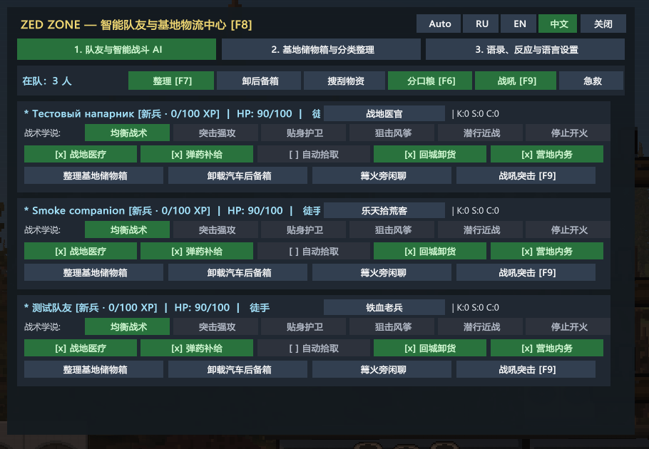
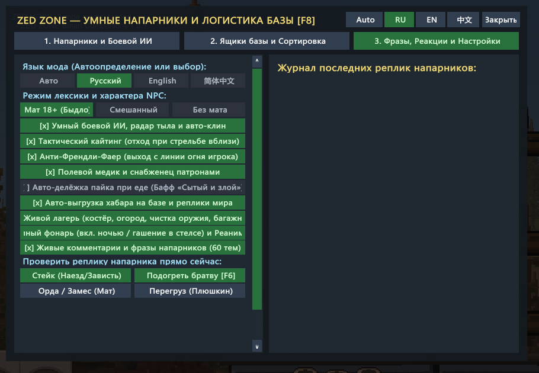
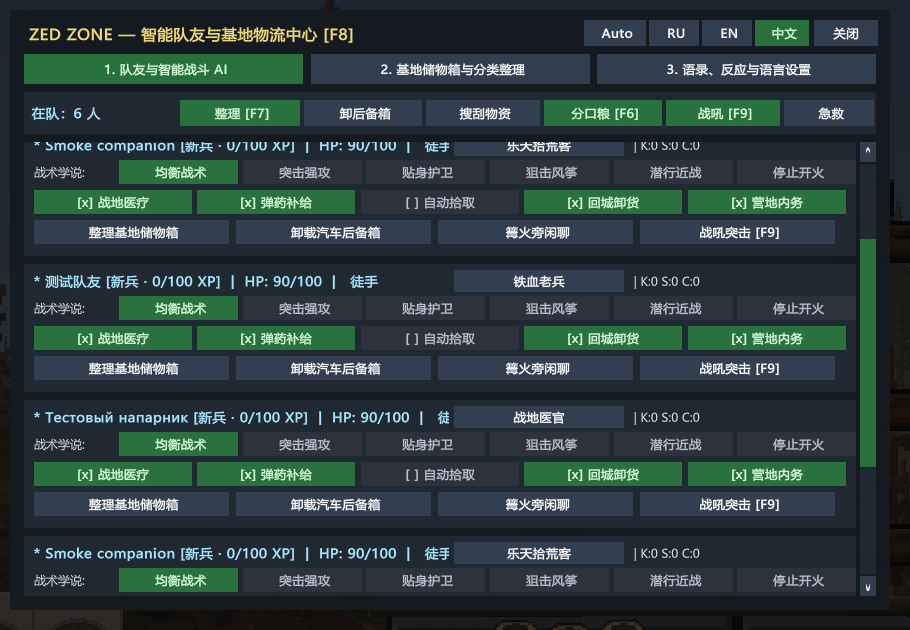

# 1.3.1 verification

## Scope and evidence

Graphical ZED ZONE (Unity 2023.1.18f1, IL2CPP x64, BepInEx 6 be.793), not `-nographics`.
The temporary `tools/UiSmoke` plugin renders the production UI with inert native fixtures in the main-menu scene. It is not included in the release or left installed.

| Check | Result |
|---|---|
| Release build with `--warnaserror` | 0 warnings, 0 errors |
| Harmony installation | 24 game methods patched |
| Startup data verification | `[SelfVerify] PASS v1.3.1` |
| Real graphical repaints | `[UiSmoke] PASS 15/15`; 15 screenshots |
| Languages | RU / EN / Simplified Chinese |
| Per-language cases | squad with 3 NPCs; base containers; settings; no companions; scrolled 6-entry squad |
| Font | Microsoft YaHei; Latin, Cyrillic and Chinese glyphs checked in engine |
| GUI state | dirty incoming scale/colors/disabled state normalized and restored |
| Native player input gates | stopAllInput=true, CanPressMouse=false, CanControlMouseActions=false during F8 |
| Actual native attack detours | Human Fire, Fire_Gun, MeleeAttack and held melee blocked for player, not companions |
| Close-frame behavior | player attack remains blocked on closing frame; controls and all attack paths restore after release |
| Scene/null safety | unknown NPC attack remains allowed when GameController absent; null character wrapper safely ignored |
| Final run errors / mod warnings | 0 / 0 |
| Save integrity | all 8,355 GameData files unchanged by SHA-256 comparison |

Raw final probe log: [ui-smoke-1.3.1.log](ui-smoke-1.3.1.log).

## Screenshots visually checked

## Honest limits

- Player saves were not loaded. These are real engine render/native-detour tests using disabled native fixtures, not a manual play-through at the owner's base.
- Native input/weapon calls use a final test-only prefix to prevent original weapon bodies from executing. Tests observe whether the production patches permit them; no objects are damaged. This does not claim a live damage/physics test against a loaded base.
- Fixtures cover populated companion cards and an empty base-container list. Chest contents, long-term AI, co-op and the separate suggestion of independent supply trips were not retested or added by this UI hotfix.
- Baseline Il2CppInterop signature fallback and older duplicate Workshop assembly-skip warnings remain; these are not mod exceptions. The final run contains zero error entries and zero Smart Companions warning entries.
- Initial probes deliberately exposed failures (settings null guard, wrong base attack target and incomplete fixture assumptions). They were not counted as passing verification. The final run fails if the UI used an error fallback; three repaints alone do not count as a pass.

## Root causes and fix

1. Public `GUI.BeginScrollView`/`EndScrollView` wrappers exist in the interop DLL but throw `Method unstripping failed`. They are replaced by retained native clipping groups with explicit scrolling.
2. Public dynamic font constructors/factories are stripped too. The retained font-creation engine call is invoked directly on an allocated native Font, and glyph coverage is validated before use.
3. `Event.Use()` does not consume Unity polled mouse input. Native CharacterInput gates and actual Human attack overrides now isolate the UI without blocking NPCs or global Unity input.
4. Harmony must target the concrete Human overrides, not assume a Basic hook intercepts them. Do not detour merged/no-op base weapon stubs.

© 2026 druidqwerty. MIT License. Free and open source; AI-assisted code, direction and testing by druid.
