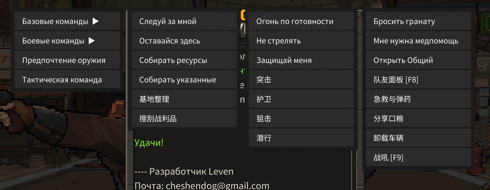

# 1.3.2 verification — PASS

RELEASE_READY: true

## Final build

- Release build with warnings treated as errors: 0 warnings, 0 errors.
- DLL SHA-256: `d4e8daf8b4f6d87e384eefa9f6a37b3b451f1e7c1c5b5a44b4cd31e676bb144b`.
- BepInEx startup: 29 native methods patched; `[SelfVerify] PASS v1.3.2`.
- Final combat, native-menu and F8 runs: zero error entries and zero Smart Companions warnings. Baseline loader duplicate-version/signature notices are not mod exceptions.

## Real native firing in a copied world

A fresh copy of the owner's world was loaded through the actual game. Existing companion equipment and a real native zombie were used. Other hostiles were temporarily parked to isolate target choice; the target's movement and health were stabilized for the observation. No target was inserted into threat data and no Fire method was called by the test.

| Final acceptance case | Observed result |
|---|---|
| Target 8 m away | Acquired in 0.75 s; first actual shot in 1.36 s |
| Target moved to 12 m | Already-tracked target reacquired in 0.01 s; shot in 0.36 s |
| Actual same-weapon discharge | Rifle item 406, native weapon identity tracked, ammo 8→7→6; fire-frame advanced |
| StopFire | Full three-second observation with living target; no shot |
| Camera state | Target remained camera-culled outside the scoped native scan; ordinary range/LOS/height/faction checks retained |

Earlier successful runs measured 0.15 s acquisition / 0.49 s first shot at 8 m and 0.42 s firing at 12 m. These are observations, not guaranteed reaction times for every weapon/world.

Evidence: [combat-acceptance-1.3.2.log](combat-acceptance-1.3.2.log).

## Native menu and F8

- Exactly four native categories; 13 vanilla + 11 custom commands, no extra empty prefix groups.
- Actual native BuildPanelUI/CreateButton labels verified for Russian, English and Chinese mod modes; vanilla labels retain the game's language.
- Seven native command executions confirmed bare stored action values; full-path/leaf/legacy custom labels match.
- Native menu screenshots captured and visually inspected, including compact labels and Chinese glyphs.
- F8 `[UiSmoke] PASS 15/15`: all three tabs in RU/EN/ZH, empty squads and six-entry scrolled lists.
- Native input assertions: player attacks/controls blocked while F8 open and on closing frame, restored after release; companion attacks unaffected.
- UI fixtures survive menu scene transitions; destroyed fixtures cannot count as a passing render/input case.

Evidence: [native-menu-1.3.2.log](native-menu-1.3.2.log), [ui-smoke-1.3.2.log](ui-smoke-1.3.2.log).

## Inventory and persistence

Native disposable-inventory tests passed: full-destination rejection, repeated rejection preserves quantities, successful whole-item transfer, exact one-food consumption and no-food rejection. XP is marked dirty between rank-ups, saved with a five-second debounce, and flushed at shutdown.

All 8,357 original GameData files match the pre-test SHA-256 baseline. Save paths were redirected to a disposable copy and cloud saving disabled during the lab. Temporary test plugins were removed from active Mods after verification and are not packaged.

## Root causes resolved

- Native command paths and label keys were confused with dialogue localization envelopes.
- Native sight was gated by camera culling and a seven-frame phase; repeated refresh alone did not guarantee discovery.
- Following could outrank a distant FireAtWill threat, then PullOutWeapon selected the first occupied slot instead of preserving the gun.
- Native equip and ranged-attack selectors disagreed about liquid/energy/battery-fed weapon eligibility, causing repeated switches. Eligibility now matches the native equip action without removing items.
- Re-equipping the exact already-drawn gun could recreate it and reset aiming.

Detailed local-engine analysis: [native-perception-analysis-1.3.2.md](native-perception-analysis-1.3.2.md).

## Limits

This is controlled single-hostile copied-world combat plus real native UI/input/inventory tests, not a full horde/co-op soak or a damage-balance test. Target health was protected to avoid death from the owner's weapon damage interrupting the cease-fire check. Liquid/energy/battery-fed items remain in inventory but are excluded from autonomous companion weapon selection because the native equip action cannot use them. Earlier failed probes are retained in the local journal; they are not counted as passes.

© 2026 druidqwerty. MIT License. Free and open source; AI-assisted code, direction and testing by druid.
